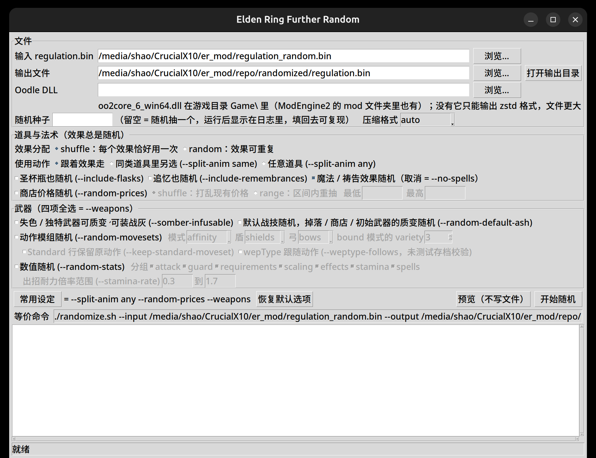

# 艾尔登法环 regulation.bin 随机器

直接改写《艾尔登法环》的 `regulation.bin`：打乱道具的使用效果、魔法/祷告的效果、商店价格，以及武器的质变、
动作模组、默认战灰和数值。输入可以是原版文件，也可以是雾门随机器 / 道具随机器已经改过的文件，
所以能和它们叠加使用。

## 快速开始：图形界面（Windows）

不需要安装任何东西：

1. 到 [Releases](https://github.com/WenchengDShao/elden_ring_further_random/releases/latest) 下载 `ERFurtherRandom.exe`。
2. 把游戏目录 `Steam\steamapps\common\ELDEN RING\Game\` 里的 `oo2core_6_win64.dll` 复制到 exe 旁边
   （没有它只能输出体积更大的 zstd 格式）。
3. 双击 exe，几秒后出现窗口：选“输入 regulation.bin”（原版，或雾门 / 道具随机器已经改过的文件），
   点“常用设定”（= 道具动作与效果分开随机 + 商店价格随机 + 武器四项全开），再点“开始随机”。
4. 约两分钟后弹窗提示完成，把生成的文件覆盖 mod 目录里的 `regulation.bin` 即可生效；随机结果清单
   `mapping.txt / weapons.txt / spells.txt` 在输出文件旁边。



exe 自带 Python、tkinter、Tcl/Tk 和依赖库，64 位 Windows 10 / 11 都能直接运行。它没有数字签名，首次运行可能被
SmartScreen 拦下（“更多信息 → 仍要运行”），Defender 偶尔会误报 PyInstaller 打包的程序。
窗口里每个控件对应一个命令行选项，细节见下文“图形界面”；从源码运行（`randomize_gui.bat`）、Linux 和命令行用法
见“安装”和“用法”。

## 兼容性

- 游戏 **1.16.1** 测试通过（2026 年 10 月），开发时用的原版文件也来自 1.16.1。其他版本没有测过：只要
  regulation.bin 的表结构没变（小版本更新通常如此）就能用，但生成的文件只能用于和输入文件同版本的游戏。
- 不要带着改过的 regulation.bin 联机，会触发 EAC / 封禁。
- Linux、WSL（Windows Subsystem for Linux）和 Windows 原生都能跑。Windows 上用 `randomize.bat`，Python 直接
  加载游戏的 DLL，不需要 WSL 和 linoodle（Windows 10 实测通过）。`--compression zstd` 不依赖 DLL。

图形界面：`randomize_gui.bat` 和 `build_exe.bat` 打包出的 exe 都在 Windows 10 实测通过（Linux 上也测过）。

## 安装

无论哪种环境，都要把游戏目录（`Steam/steamapps/common/ELDEN RING/Game/`）里的 `oo2core_6_win64.dll`
复制到仓库目录，这个 DLL 不随仓库分发。

### Windows

只想用图形界面的话直接下载 Release 里的 exe（见开头“快速开始”），不用装 uv。下面是从源码运行的步骤：

1. 安装 [uv](https://github.com/astral-sh/uv)：在 PowerShell 里运行
   `powershell -ExecutionPolicy ByPass -c "irm https://astral.sh/uv/install.ps1 | iex"`（没有 Python 时 uv 会自动下载）。
2. 下载或 `git clone` 本仓库，把 `oo2core_6_win64.dll` 复制到仓库目录。
3. 在仓库目录运行 `randomize.bat`，参数与 `randomize.sh` 相同，例如
   `randomize.bat --input "D:\path\regulation.bin" --output regulation_new.bin --split-anim any --random-prices --weapons`。

也可以用图形界面：运行 `randomize_gui.bat` 打开窗口，选文件、勾选项、点“开始随机”即可（同样需要 uv；它会保留
一个黑色控制台窗口用来显示错误信息）。
想要一个不依赖 uv / Python 的单文件程序：运行 `build_exe.bat`，它用 PyInstaller 打包出 `dist\ERFurtherRandom.exe`，
把它和 `oo2core_6_win64.dll` 放在同一目录就能双击运行（见下文“图形界面”）。

不需要 WSL。`randomize.bat`、`randomize_gui.bat` 和 `build_exe.bat` 打包出的 exe 都在 Windows 10 实测通过。

### Linux / WSL

以 Ubuntu 为例（WSL 在 WSL 终端里执行）：

```bash
sudo apt update && sudo apt install -y git curl python3
curl -LsSf https://astral.sh/uv/install.sh | sh        # 安装 uv，装完重开终端
git clone https://github.com/WenchengDShao/elden_ring_further_random.git ~/elden_ring_further_random
cd ~/elden_ring_further_random
cp "/mnt/c/Program Files (x86)/Steam/steamapps/common/ELDEN RING/Game/oo2core_6_win64.dll" .   # 按实际游戏路径改
./randomize.sh --input /path/to/regulation.bin --output ./regulation_new.bin --split-anim any --random-prices --weapons
```

`randomize.sh` 第一次运行时会在 `~/.venvs/er_mod` 建虚拟环境并安装依赖。WSL 里仓库建议放在 WSL 自己的
文件系统（如 `~/`），输入输出文件可以用 `/mnt/<盘符>/...` 指向 Windows 上的文件。

图形界面：`./randomize_gui.sh`（需要 tkinter，系统 Python 缺它时 `sudo apt install python3-tk`；WSL 需要 WSLg 或
X 服务器才能显示窗口）。`./build_exe.sh` 把它打包成 Linux 单文件程序 `dist/ERFurtherRandom`。

预编译的 `tools/linoodle/liblinoodle.so` 适用于 Ubuntu 18.04 / Debian 10 以后的 x86_64 发行版。如果运行时报
`version ... not found` 或 `cannot open shared object file`，重编一次即可：

```bash
sudo apt install -y git cmake g++
tools/linoodle/build.sh
```

DLL 的查找规则、linoodle 和 `build.sh` 的细节见下文"Oodle DLL 与 linoodle"。

## 用法

### 常用设定

```bash
./randomize.sh --input /path/to/targeted/regulation.bin --output ./regulation_new.bin --split-anim any --random-prices --weapons
```

`/path/to/targeted/regulation.bin` 是要随机的文件（原版，或雾门 / 道具随机器已经改过的文件），结果写到
`regulation_new.bin`，映射表 `mapping.txt`、`weapons.txt`、`spells.txt` 写在同一目录；`regulation_new.bin`
需要覆盖原文件以生效。这一条包含的随机：

- 道具使用效果（总是做）：每个可使用道具拿到另一个道具的使用效果，shuffle 模式每个效果恰好用一次。
- `--split-anim any`：使用动作和效果分开随机，动作从整个池子里挑，投掷类效果也可能配吃 / 涂抹的动作；
  魔法 / 祷告的施放动作同样从全池里挑。
- 魔法 / 祷告效果（总是做）：魔法和祷告同池互换效果，各自保留魔法 / 祷告归属。
- `--random-prices`：商店里道具的卢恩价格在条目间打乱。
- `--weapons`：失色 / 独特武器获得全部 12 种质变并可装战灰（`--somber-infusable`）；每个（武器, 质变）行换成随机
  武器的动作模组，盾只在盾的动画集之间换、弓弩只在弓弩类之间换（`--random-movesets`，affinity 模式）；
  默认战技随机，掉落表 / 商店 / 初始职业给出的武器改成随机质变（`--random-default-ash`）；攻击、防御、必需能力值、
  能力加成、异常积累、出招耐力全部随机，法术的专注值 / 耐力 / 必需能力值也随机（`--random-stats`，全部分组）。
- 没给 `--seed`，种子随机生成并打印在开头；想复现就把它加回去（`--seed N`）。压缩用默认的 Kraken（需要 DLL）。

### 其他示例

```bash
./randomize.sh --seed 1                        # 读 regulation.bin，写 randomized/regulation.bin 和映射表
./randomize.sh --input regulation_random.bin --output /path/to/mod/regulation.bin --seed 1848 --split-anim any --random-prices --weapons
./randomize.sh --dry-run                       # 只打印映射，不写文件
./randomize.sh --help                          # 全部选项
```

`--seed` 不给时随机生成并打印，记下来即可复现。输出目录里会生成 `mapping.txt`（道具效果、价格）、
`weapons.txt`（武器）、`spells.txt`（法术）。生成的 `regulation.bin` 放到 ModEngine2 的 `mod/regulation.bin`
（和雾门随机器同用时放到它的 `mod/fog/regulation.bin`，以 ModEngine2 配置里先加载的目录为准）。

### 选项一览

| 选项 | 作用 |
|---|---|
| （总是） | 每个可使用道具拿到另一个道具的使用效果 |
| `--mode shuffle\|random` | `shuffle`（默认）每个效果恰好用一次；`random` 允许重复 |
| `--include-flasks`、`--include-remembrances` | 把圣杯瓶 / 追忆也加入道具池（默认都不加） |
| `--split-anim [same\|any]` | 使用动作和效果分开随机；`same` 只在同类动作里挑，`any` 全池 |
| （总是） | 每个魔法/祷告拿到另一个法术的效果；`--no-spells` 关闭 |
| `--random-prices` | 商店里道具的卢恩价格；`--price-mode shuffle\|range`、`--price-min N`、`--price-max N` |
| `--weapons` | = 下面四项 |
| `--somber-infusable` | 失色/独特武器获得全部 12 种质变并可装战灰 |
| `--random-movesets` | 每个（武器, 质变）行换成随机武器的动作模组；`--moveset-mode affinity\|bound\|weapon`、`--shield-movesets shields\|none\|all`、`--bow-movesets bows\|none`、`--keep-standard-moveset`、`--weptype-follows` |
| `--random-default-ash` | 默认战技随机；掉落表 / 商店 / 初始职业给出的武器改成随机质变 |
| `--random-stats` | 攻击、防御、必需能力值、能力加成、异常积累、出招耐力随机；`--stat-groups` 选子集，`--stamina-rate LO,HI` |
| `--compression auto\|kraken\|zstd\|leviathan` | 输出压缩格式，见下文 |

### 图形界面

Release 里的 `ERFurtherRandom.exe`（见开头“快速开始”）、`randomize_gui.bat`（Windows，从源码运行）和
`./randomize_gui.sh`（Linux）打开的是同一个窗口；`build_exe.bat` 可以自己打包 exe。窗口里的每个控件对应一个
命令行选项，底部“等价命令”实时显示同样设置的命令行。

- 文件：输入 regulation.bin、输出文件、Oodle DLL（启动时自动填入 exe / 仓库目录里的 `oo2core_6_win64.dll`，
  没有就留空，开始时会询问是否改用 zstd 格式）、随机种子（留空则随机抽一个，日志里会显示）、压缩格式。
- “常用设定”按钮 = `--split-anim any --random-prices --weapons`；“预览（不写文件）” = `--dry-run`；
  “开始随机”生成文件，完成后提示输出位置，`mapping.txt / weapons.txt / spells.txt` 写在输出文件旁边。
- 日志区显示命令行的全部输出；Kraken 压缩约需 2 分钟，期间窗口保持响应。
- 打包出的程序带 `--` 开头的参数运行时就是命令行工具（参数与 `randomize.py` 相同；Windows 的 windowed 程序
  没有控制台输出，结果看输出文件旁的 `mapping.txt` 等）。
- 自己打包的 exe 和 Release 里的一样，可以复制到别的 64 位 Windows 10 / 11 电脑上用，对方不用装 uv 或 Python，
  只要把 `oo2core_6_win64.dll` 放在 exe 旁边；每次启动先解压到临时目录，要等几秒。仓库本身不收 exe（`dist/`
  已忽略），发布时作为 Release 附件上传。
- 窗口没有出现时：错误信息会弹窗显示，并写进程序（exe 或仓库目录）旁边的 `gui_error.log`。uv 自动下载的
  Python 在虚拟环境里自己找不到 Tcl 的脚本库（init.tcl），`gui.py` 启动时会补上路径，`build_exe.bat` 打包前用
  `tools/tkcheck.py` 检查 Tk 并把 `TCL_LIBRARY` / `TK_LIBRARY` 传给 PyInstaller。Python 根本没带 tkinter 时
  （python.org 安装包要勾选 “tcl/tk and IDLE”）两者都会明确报错。

## 道具效果随机

把 `EquipParamGoods` 中每个可使用道具的"效果"换成另一个道具的效果，道具本身（名字、图标、价格、堆叠上限、
重量）不变。"效果"包括效果引用（`refCategory / refId_* / spEffectCategory / behaviorId` 等）、使用动画和特效
（`goodsUseAnim / castSfxId / fireSfxId / opmeMenuType`）、消耗与使用条件；默认动画和效果一起搬，
所以"吃肉干 → 扔出火焰壶"会按来源道具的方式正常播放。

- 纳入：所有能在背包里"使用"的道具（`goodsType` 0/1、有效果、不是纯联机道具），消耗品和可反复使用的工具都在内
  （投掷壶、飞刀、香水、丸药、肉干、油脂、各种卢恩、望远镜、提灯、囚具、纯血骑士勋章、米凯拉大卢恩、恩典记忆等）。
  可反复使用的工具保持可反复使用，拿到什么效果就能无限用（包括卢恩，这是有意的）。
- 排除：圣杯瓶、灵药圣杯瓶、灵马哨笛、骨灰和骨灰召唤铃、结晶露滴、纯联机道具、素材、会打开菜单的道具、占位行。
- `--split-anim`：动作字段再从另一个道具取。`same` 只在同一类效果（投掷类 / 吃涂类）的道具里挑，因为两类动画
  触发效果的 TAE 事件不同；`any` 不限类，跨类能否触发未实测。

## 魔法与祷告效果随机

魔法和祷告放在同一个池子（215 个玩家可学的法术），每个法术保留自己的 ID、图标、魔法/祷告归属和施放介质，
搬过来的是效果引用、专注值/耐力消耗、必需能力值、记忆格数和附魔标志；施放动作（`refType`、特效、敏捷施法速度、
能否骑马施放）默认跟着效果走，`--split-anim same` 只在动作槽位签名相同的法术间换动作，`any` 全池。
法杖和圣印共用动作库，所以魔法动作换到祷告上也有动画。

`--random-stats`（分组 `spells`）另外随机专注值消耗（0-10 占 50%、11-20 占 30%、21-40 占 20%）、
耐力消耗（0-20 / 21-40 / 41-60）和 1-3 项必需能力值（总和不超过 60），记忆格一律 1。

## 价格随机

商店价格写在 `ShopLineupParam.value` 里，该选项改道具条目（含魔法、食谱、锻造石、消耗品）中以卢恩计价的价格；
免费条目和用龙心等特殊货币的条目不动。`shuffle` 在条目间打乱现有价格，`range` 在区间内按对数均匀抽新价格。

## 武器

武器 ID = 基础 ID + 质变×100 + 强化等级；`EquipParamWeapon` 每把武器每种质变一行，强化等级由
`ReinforceParamWeapon` 在运行时套用。

- **`--somber-infusable`**：只有标准质变行的近战武器和盾（176 把）各新增 12 行质变，数值按同类型可质变武器的
  比例推算，强化曲线沿用失色原值（仍 +10 封顶），`gemMountType` 设为 2 以便装战灰。新增行没有文本条目，
  质变版本在菜单里可能显示为空名。
- **`--random-movesets`**：模组 = 动画集 + 攻击行为块（`wepmotionCategory / wepmotionOneHandId /
  wepmotionBothHandId / spAtkcategory / behaviorVariationId / isDualBlade / isThrustAttackType`），整套拷贝自
  同一把来源武器；`weaponCategory` 和 `guardmotionCategory` 保留，左手盾按 L1 仍是举盾。
  - `affinity`（默认）：每把武器的 13 个质变行各抽一个模组，`wepType` 不动，近战战灰全部解锁到所有近战武器和盾
    （`weapons.txt` 末尾列出每种武器类型有动画的战灰，装错了战技没有动作）。`--keep-standard-moveset` 标准行不动；
    `--weptype-follows` 让随机行连 `wepType` 一起换，铁匠处列表严格等于有动画的战灰，但读档校验未实测。
  - `bound`：战灰与动画严格绑定。12 种质变各有一簇动画集（`--moveset-variety N`，默认 3），每把武器每个质变从簇里
    抽，最后按结果收窄每个战灰的可选质变位，铁匠处只会列出有动画的质变。
  - `weapon`：每把武器一个模组，13 种质变共用，`wepType` 跟着换；盾牌不参与。已装战灰在新种别不可装时读档会报错。
  - 盾（`--shield-movesets`）：默认只在小盾/中盾/大盾/刺击盾四种动画集之间换；`none` 不换；`all` 随便换
    （左手盾按 L1 会出攻击）。弓弩（`--bow-movesets`）只在弓弩类之间换，`wepType` 不动。
- **`--random-default-ash`**：每个质变行的默认战技换成随机战灰（115 个可获得的战灰，按该行实际动画集选，保证有动画）；
  掉落表、商店、初始职业给出的武器改成随机质变版本（保留强化等级）。
- **`--random-stats`**：每个质变行（弓弩、法杖、圣印只有一行，火把不动）随机：
  - `attack` 五种属性攻击力取同类随机一行的原版数值并打乱，每项 ±15%；致命倍率、削韧、冲击力各自抽。
  - `guard` 减伤率、防御强度、异常抗性，盾和武器各自的区间；弓弩跳过。
  - `scaling` 1-4 个属性分一笔加成预算，补正曲线随机，并新建 `AttackElementCorrectParam` 行让每个加成属性对所有
    伤害类型生效；重型行不抽敏捷；弩改用普通/失色强化表才有加成。
  - `requirements` 每项 0-10 / 11-20 / 21-30 / 31-40 / 41-60 按 40 / 30 / 20 / 9 / 1 % 抽，总和超过 60 时按比例下调。
  - `effects` 0-2 种异常积累（出血、中毒、腐败、冻伤、催眠、发狂），出血/中毒/冷气强化表的行放会随强化增长的系列。
  - `stamina` `staminaConsumptionRate` 在 `--stamina-rate` 区间内均匀随机（默认 0.3-1.7）。
  - 所有行 `isEnhance` = 1，任何属性都能涂油脂。

随机顺序是道具 → 武器 → 法术，同一 seed 加法术随机后武器结果不变。

## 文件大小限制与压缩格式

游戏把 regulation.bin 的副本存进存档，文件超过 **0x240000 = 2,359,296 字节** 主菜单就会提示"存档数据损坏"，
和内容无关。`--random-stats` 最占空间，zstd 全开时只剩约 30 KB 余量，所以默认用 `kraken`：

- `kraken`（默认，找到 DLL 时）：原版自己的 DCX `KRAK` 格式（Oodle Kraken，Optimal5），必须按 256 KB 块独立压缩
  （`seekChunkLen = 0x40000`，否则游戏启动闪退）。同一份内容 zstd 2,325,744 字节、Kraken 1,724,032 字节，
  游戏内验证通过。Kraken 压缩约 2 分钟，zstd 约 40 秒。
- `zstd`：雾门/道具随机器用的 64 KB 窗口 zstd，找不到 DLL 时的退路；窗口不能更大（`--zstd-window 22` 游戏闪退）。
- `leviathan`：同样的 KRAK 头里放 Leviathan 流，文件最小，游戏是否接受未测。

保存时压缩等级逐级提高直到装下，装不下就报错而不是写出游戏拒绝的文件；运行结束会打印剩余余量。

## Oodle DLL 与 linoodle

- **DLL 查找**：默认只在当前目录找 `oo2core_6_win64.dll`，也可以用 `--oodle-dll PATH` 或环境变量 `OODLE_DLL`
  指定。找不到时会说明并询问路径，只有明确放弃才回退到 zstd，非交互运行时直接报错退出。除游戏目录外，
  ModEngine2 的 `mod/fog/`、`mod/randomizer/` 里也各有一份 DLL。
- **Windows**：`tools/oodle.py` 在 `sys.platform == "win32"` 时用 `ctypes.WinDLL` 直接加载 DLL，其余代码不变。
- **Linux / WSL**：DLL 由 `tools/linoodle/liblinoodle.so`（McSimp/linoodle 的 PE 加载器）加载。仓库里的 .so 用
  Zig 以 glibc 2.28 为目标编译并静态链接 libc++，实际只依赖 glibc 2.17，不依赖 libstdc++，所以老一些的发行版
  也能加载。
- **`tools/linoodle/build.sh`**：克隆 McSimp/linoodle 并编译，结果覆盖 `tools/linoodle/liblinoodle.so`。脚本把
  第三方的 pe-parse 改为 `-w` 编译（原本的 `-Werror` 在新版 g++ 下会因为警告而失败），补上新版编译器缺的头文件，
  编译过程没有警告。本机 g++ 编出的库依赖本机的 glibc / libstdc++ 版本；要编出和仓库里一样的通用版，下载一份
  [Zig](https://ziglang.org/download/)（0.15.x，解压即用）后运行 `ZIG=/path/to/zig/zig tools/linoodle/build.sh`。

## 实现原理

`regulation.bin` = 16 字节 IV + AES-256-CBC（公开密钥）加密的 DCX，加密前补零到 16 字节再加一整块 PKCS#7 填充
（缺了游戏启动闪退）。DCX 解压后是 BND4，内含 194 个 `.param`，用 Paramdex 的 paramdef 解析行结构。改过的
param 重新序列化（支持新增行），没动过的原字节写回，再压缩、加密。`tools/erreg.py` 是这部分的全部实现。

## 已知限制

- 结构上做了校验（新增行可解析、ID 有序、引用指向存在的行、其余表字节一致），游戏内只验证了主要路径。
  未实测：`--split-anim any` 的跨类组合能否触发、新建的 `AttackElementCorrectParam` 行是否生效、弩换强化表后的加成、
  `--weptype-follows` 的读档校验、`isEnhance` = 1 后原版不能上油的行是否真能涂油脂、`leviathan` 格式。
- 做不到的：**任意地点召唤骨灰**（`BuddyStoneParam` 的范围字段只覆盖一个写死在程序里的默认半径，改了没效果，
  需要 DLL）；**强化等级上限随存档里已强化的最高等级变化**（regulation.bin 读不到存档；掉落表给固定 +N 可以，
  但动态上限要改事件脚本或写 DLL）。

## 文件

- `tools/erreg.py` — 解密 / 解压 / BND4 / PARAM 读写库
- `tools/randomize.py` — 命令行入口，道具效果与价格随机
- `tools/weapons.py` — 武器四项功能
- `tools/spells.py` — 魔法 / 祷告随机
- `tools/oodle.py`、`tools/linoodle/` — 通过游戏自带的 `oo2core_6_win64.dll` 做 Kraken / Leviathan 压缩
  （Linux / WSL 经 linoodle 加载，Windows 直接 ctypes 加载）
- `tools/paramdef/*.xml`、`tools/names/*.txt` — 来自 soulsmods/Paramdex 的表结构和行名
- `randomize.sh`、`randomize.bat` — 一键运行（Linux / WSL、Windows）
- `tools/gui.py` — 图形界面（tkinter，不需要额外依赖），`randomize_gui.sh`、`randomize_gui.bat` 启动它；
  `tools/tkcheck.py` — 打包前的 Tk 检查，输出 Tcl / Tk 库路径
- `build_exe.sh`、`build_exe.bat` — 用 PyInstaller 把图形界面打包成单文件程序，输出在 `dist/`

## 致谢

- 本项目的代码由 [Claude Code](https://claude.com/claude-code) 编写，作者负责需求、游戏内测试和取舍。
- [soulsmods/Paramdex](https://github.com/soulsmods/Paramdex)：paramdef 和行名；[SoulsFormats](https://github.com/JKAnderson/SoulsFormats)：DCX / BND4 格式参考。
- [McSimp/linoodle](https://github.com/McSimp/linoodle)：在 Linux 上加载 Oodle DLL 的 PE 加载器。
- thefifthmatt 的雾门随机器和道具随机器：本工具的输入和 zstd 帧格式的参考。
