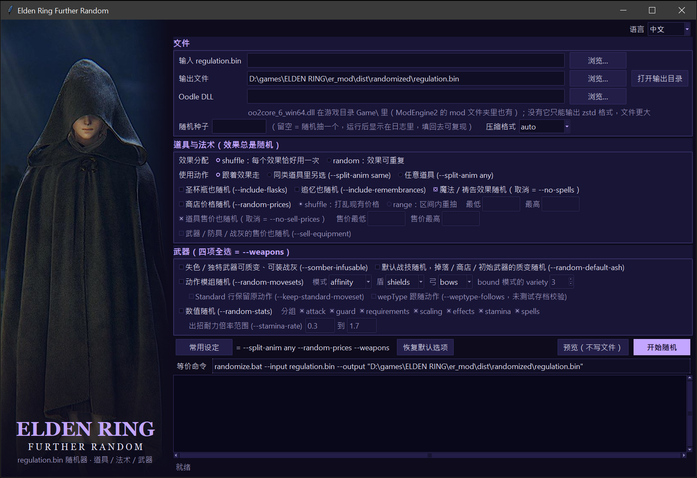

# Elden Ring Further Randomizer + Joke Shifu

[中文说明在下半部分](#艾尔登法环-regulationbin-随机器--笑话大师) · Full documentation (Chinese): [README_details.md](README_details.md) · [Releases](https://github.com/WenchengDShao/elden_ring_further_random/releases/latest)



## 1. What it is

A randomizer that rewrites Elden Ring's `regulation.bin` directly: the use effects of consumables, the effects of
sorceries and incantations, shop prices, weapon affinities / movesets / default skills / stats, where the two flasks are
found, what enemies drop and how many runes they give, how long buffs last, and the subtitles of NPC dialogue (the "joke
shifu" puts a joke under every cut line). The input can be the vanilla file or one already written by the Item and Enemy
Randomizer or the Fog Gate Randomizer, so it stacks on top of them (with me3 or Mod Engine 2). Made for game 1.17.1 /
1.17.2; a Windows executable with a GUI is in the Releases, the Python sources run on Windows, Linux and WSL. The
game's own `oo2core_6_win64.dll` is needed to write the game's Kraken format (it is not shipped; without it the output is
larger zstd). Never go online with a modified `regulation.bin`.

## 2. The preset

The GUI's **Preset** button, or on the command line:

```
--split-anim any --random-prices --weapons --random-flask-locations --random-dialogue --dialogue-jokes
```

One run with the preset shuffles the use effect of every consumable and spell (the use animation drawn separately, so a
pot may be eaten), permutes the prices of every shop and the sell prices of goods, turns all four weapon options on
(somber weapons get every affinity and Ashes of War, every weapon row gets a random moveset, default skill and random
stats), hides the Flask of Crimson Tears and the Flask of Cerulean Tears somewhere else in the world, and shuffles every
NPC subtitle over every other NPC's lines with a joke under each cut line. The result is a `regulation.bin` plus the
patched text archives (`msg\<language>\`) to drop into the mod folder, and reports (`mapping.txt`, `weapons.txt`,
`spells.txt`, `dialogue.txt`) next to them. The enemy drop, rune and duration options below are not in the preset.

## 3. Every randomization

| Option | What it does |
|---|---|
| Item effects (always on) | Every usable consumable gets the use effect of another one (`--mode shuffle` each effect once, `random` with repeats); `--include-flasks` / `--include-remembrances` add those to the pool; `--split-anim same\|any` draws the use animation from a different item. |
| Spell effects (always on, off with `--no-spells`) | Every sorcery and incantation gets the effect of another spell, both kinds in one pool; `--split-anim` also separates the cast animation. |
| `--random-prices` | Shop prices and the sell prices of goods are permuted (or redrawn in a range with `--price-mode range`); `--sell-equipment` includes weapons, armor and Ashes of War, `--no-sell-prices` keeps the sell prices. |
| `--random-durations` | How long the buffs of consumables (greases, meats, blessings...) and of spells (weapon buffs, Golden Vow...) last is permuted, or redrawn between `--duration-min` / `--duration-max` seconds with `--duration-mode range`. |
| `--random-flask-locations` | The two flasks are found at a random pickup, boss, NPC gift or merchant instead, and the first Site of Grace gives what was there. |
| `--random-enemy-drops` | Every enemy always drops something, and what it drops is random (anything the game hands out anywhere, no key items); one-time drops stay. |
| `--enemy-drop-rolls N` `--enemy-drop-chance P` | With the above: every enemy gets exactly N drop rolls at P % each, so a kill drops 0 to N items. |
| `--random-runes` | The runes every enemy gives are permuted over the enemies (a rat may be worth a dragon), or redrawn in a range with `--rune-mode range`. |
| `--somber-infusable` | Somber / unique weapons get all 12 affinities and can mount Ashes of War; the new rows are named in the game's text (`--weapon-names`, automatic). |
| `--random-movesets` | Every melee weapon and shield gets the moveset of a random other weapon or shield (shields and bows among their own kind; `--moveset-mode affinity\|bound\|weapon`). |
| `--random-default-ash` | A random default skill per weapon and affinity, and a random affinity on the weapons given by item lots, shops and starting classes. |
| `--random-stats` | Random attack, guard, requirements, scaling, status build-ups and stamina cost on every weapon row, plus FP / stamina / requirements of spells (`--stat-groups` picks a subset). |
| `--weapons` | Shortcut for the four weapon options above. |
| `--random-dialogue` | The subtitles of NPC dialogue are shuffled over every NPC's lines; the voices stay, so each NPC still speaks its own line. |
| `--dialogue-jokes` | Joke shifu: the game's cut lines (an id without a text) each get a joke and join the shuffle; the patched text archives are written next to the output. |
| `--pool-first` | Per language a pool is shown first, each line once (Chinese: lines of the 2010 TV series Three Kingdoms + jokes, English: jokes), then the game's own lines. |
| `--mixed-pool` | Every subtitle comes from one heap per language (Three Kingdoms + jokes + the game's lines after 20 machine translations); the original lines are gone. |
| `--translate20` | Every subtitle is replaced, id for id, by the same line after 20 machine translations; works alone or with the shuffle. |

Not random but included: `--start-with-bell` / `--start-with-lantern` hand out the Spirit Calling Bell and the Lantern at
the start (for Fog Gate Randomizer runs), `--repack` only re-compresses a `regulation.bin` another tool wrote (fixes Fog
Gate Randomizer output that crashes game 1.17.1). Every option, its details and the test status are in
[README_details.md](README_details.md).

---

# 艾尔登法环 regulation.bin 随机器 + 笑话大师

[English above](#elden-ring-further-randomizer--joke-shifu) · 完整说明：[README_details.md](README_details.md) · [Releases](https://github.com/WenchengDShao/elden_ring_further_random/releases/latest)

## 1. 这是什么

直接改写《艾尔登法环》`regulation.bin` 的随机器：道具的使用效果、魔法 / 祷告的效果、商店价格、武器的质变 / 动作模组 /
默认战技 / 数值、两个圣杯瓶的获得位置、敌人掉什么和给多少卢恩、buff 持续多久，以及 NPC 对话的字幕（“笑话大师”给每句
被砍的台词配一条冷笑话）。输入可以是原版文件，也可以是道具随机器 / 雾门随机器已经改过的文件，所以能叠在它们之上用
（me3 或 Mod Engine 2）。适配游戏 1.17.1 / 1.17.2；Releases 里有带图形界面的 Windows 程序，Python 源码在 Windows、Linux、
WSL 上都能跑。写游戏自己的 Kraken 格式需要游戏目录里的 `oo2core_6_win64.dll`（不随本工具分发；没有它输出体积更大的 zstd
格式）。不要带着改过的 `regulation.bin` 联机。

## 2. 常用设定

图形界面的“常用设定”按钮，或命令行：

```
--split-anim any --random-prices --weapons --random-flask-locations --random-dialogue --dialogue-jokes
```

一次跑完：每个消耗品和每个法术换成另一个的效果（使用动作另抽，所以可能把壶吃掉），所有商店的价格和道具售价打乱，
武器四项全开（失色武器获得全部质变并可装战灰，每一行武器换随机动作模组、默认战技和随机数值），红 / 蓝露滴圣杯瓶藏到
世界上别的地方，NPC 字幕在所有 NPC 的台词之间打乱、被砍的台词各配一条冷笑话。得到的是一个 `regulation.bin` 加改好的
文本档（`msg\<语言>\`），一起放进 mod 目录即可，清单 `mapping.txt`、`weapons.txt`、`spells.txt`、`dialogue.txt` 在旁边。
下面的敌人掉落、卢恩和持续时间选项不在常用设定里。

## 3. 全部随机功能

| 选项 | 作用 |
|---|---|
| 道具效果（总是做） | 每个可使用的消耗品拿到另一个的使用效果（`--mode shuffle` 每个效果恰好一次，`random` 允许重复）；`--include-flasks` / `--include-remembrances` 把圣杯瓶 / 追忆也加进池子；`--split-anim same\|any` 让使用动作从别的道具另抽。 |
| 法术效果（总是做，`--no-spells` 关闭） | 每个魔法和祷告拿到另一个法术的效果，两类同池；`--split-anim` 同时把施放动作分开抽。 |
| `--random-prices` | 商店价格和道具售价在条目间打乱（`--price-mode range` 则在区间内重抽）；`--sell-equipment` 连武器、防具、战灰的售价一起，`--no-sell-prices` 不动售价。 |
| `--random-durations` | 消耗品（油脂、肉、祝福……）和法术（武器附魔、黄金誓约……）的 buff 持续时间在 buff 之间打乱，或用 `--duration-mode range` 在 `--duration-min` / `--duration-max` 秒之间重抽。 |
| `--random-flask-locations` | 两个圣杯瓶改到随机一处拾取物、boss、NPC 赠礼或商人那里获得，第一个赐福改给那里原来的东西。 |
| `--random-enemy-drops` | 所有敌人必定掉落、掉什么随机（游戏里能拿到的全部物品，不含关键道具）；一次性掉落不动。 |
| `--enemy-drop-rolls N` `--enemy-drop-chance P` | 配上一项：每个敌人固定 N 次判定、每次 P% 掉一件，于是一次击杀掉 0～N 件。 |
| `--random-runes` | 每个敌人给的卢恩在敌人之间打乱（老鼠可能值一条龙），或用 `--rune-mode range` 在区间内重抽。 |
| `--somber-infusable` | 失色 / 独特武器获得全部 12 种质变并可装战灰；新增行的名字补进游戏文本（`--weapon-names`，自动）。 |
| `--random-movesets` | 每把近战武器和盾换成随机另一把的动作模组（盾和弓各在自己一类里换；`--moveset-mode affinity\|bound\|weapon`）。 |
| `--random-default-ash` | 每把武器每种质变随机一个默认战技；掉落表、商店、初始职业给出的武器随机质变。 |
| `--random-stats` | 每一行武器的攻击、防御、必需能力值、能力加成、异常积累、出招耐力全部随机，法术的专注值 / 耐力 / 必需能力值也随机（`--stat-groups` 可只选几组）。 |
| `--weapons` | 以上四个武器选项的缩写。 |
| `--random-dialogue` | NPC 对话字幕在所有 NPC 的台词之间打乱，语音不动，NPC 念的还是自己那句。 |
| `--dialogue-jokes` | 笑话大师：被砍的台词（有编号没文本）各配一条冷笑话并加入随机；改好的文本档写在输出旁边。 |
| `--pool-first` | 每种语言先抽一个池子、每句一次（中文：2010 版《三国》台词 + 冷笑话，英文：冷笑话），抽完再回到游戏原文。 |
| `--mixed-pool` | 每句字幕都从一个大池子里抽（三国 + 冷笑话 + 游戏原文被机器翻译 20 次的结果），原文不再出现。 |
| `--translate20` | 每句字幕原位换成这句话本身被机器翻译 20 次之后的样子，可单独用，也可和随机合用。 |

不随机但也有：`--start-with-bell` / `--start-with-lantern` 开局就给招魂铃和携带照明灯（给雾门随机用），`--repack` 只把别的
工具写出的 `regulation.bin` 重新压缩（修复雾门随机器在游戏 1.17.1 下闪退的输出）。每个选项的细节和测试状态见
[README_details.md](README_details.md)。
