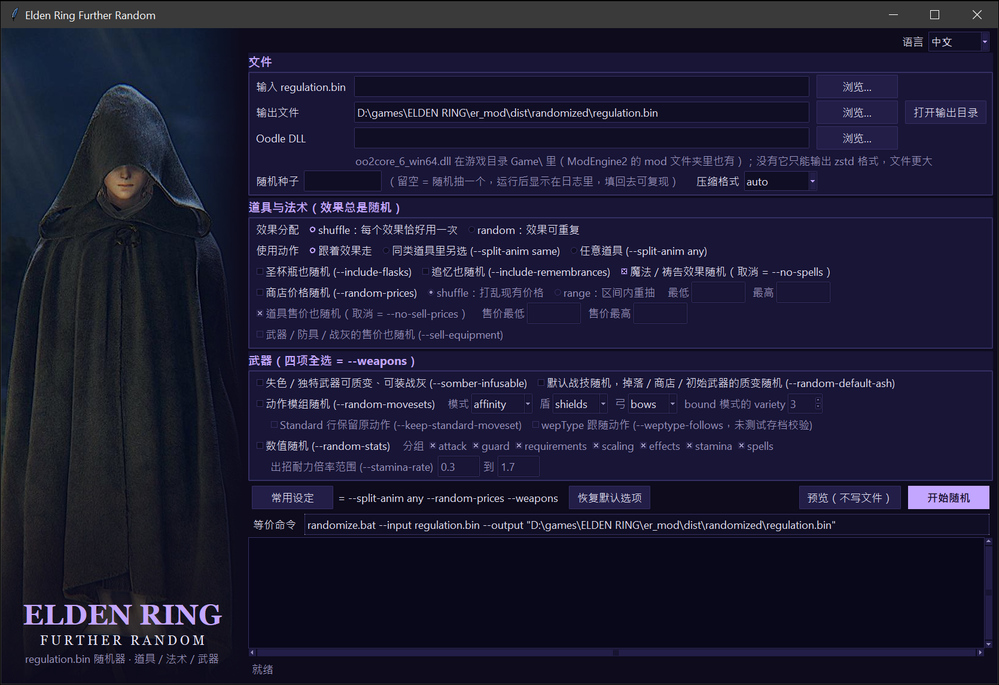

# 艾尔登法环 regulation.bin 随机器 + 笑话大师

直接改写《艾尔登法环》的 `regulation.bin`：打乱道具的使用效果、魔法/祷告的效果、商店价格，以及武器的质变、
动作模组、默认战灰和数值。输入可以是原版文件，也可以是雾门随机器 / 道具随机器已经改过的文件，
所以能和它们叠加使用。

## 快速开始：图形界面（Windows）

> **笑话大师（Joke Shifu）**：NPC 对话的字幕在所有 NPC 的台词之间打乱，原版 899 句有编号没文本的“被砍台词”各换成一条
> 冷笑话（中文、英文各 955 条），一起加入随机——于是梅琳娜可能一本正经地念出“为什么海水是咸的？因为鱼在里面哭了太久”，
> 而商人可能对你说出本该属于菈妮的台词。语音不动，NPC 念的还是自己原来那句。“常用设定”已经包含它；生成后把输出文件旁边的
> `msg\` 目录连同 `regulation.bin` 一起放进 mod 目录即可。详见下文“对话字幕随机”。

> **Fog Gate Randomizer v0.2.3 在游戏 1.17.1 下闪退的临时解决办法**：雾门随机器写出的 `regulation.bin` 会让 1.17.1 一启动
> 就退出（它的 zstd 压缩流被这版游戏的解码器拒绝，内容本身没问题）。用本程序右上角的“只重新压缩（不随机）”按钮
> （命令行 `--repack`）把 `mod\fog\regulation.bin` 重新压缩成游戏自己的 KRAK 格式，输出放进一个新的 mod 目录（比如
> `mod\fog_fix`）并在 me3 配置里排在雾门随机器之后，游戏就能正常启动，雾门随机照常生效；当然也可以顺手把常用设定一起
> 加上。每次重新跑雾门随机器后要再做一次。详见下文“与 Fog Gate Randomizer、me3 配合”。

不需要安装任何东西：

1. 到 [Releases](https://github.com/WenchengDShao/elden_ring_further_random/releases/latest) 下载压缩包，整个解压：
   里面是 `ERFurtherRandom.exe` 和笑话大师用的文本档 `msg\engus\`、`msg\zhocn\`（exe 和 msg 目录保持在一起）。
2. 把游戏目录 `Steam\steamapps\common\ELDEN RING\Game\` 里的 `oo2core_6_win64.dll` 复制到 exe 旁边
   （没有它只能输出体积更大的 zstd 格式；这个 DLL 是 RAD Game Tools 的，不随本工具分发）。
3. 双击 exe，几秒后出现窗口（默认英文，右上角 Language 可切换为中文，下次启动沿用）：选“输入 regulation.bin”
   （Input regulation.bin；原版，或雾门 / 道具随机器已经改过的文件），点“常用设定”（Preset，= 道具动作与效果分开
   随机 + 商店价格随机 + 武器四项全开 + 圣杯瓶获得位置随机 + 对话字幕随机 + 笑话大师），再点“开始随机”（Randomize）。
4. 约两分钟后弹窗提示完成，把生成的 `regulation.bin` 和旁边的 `msg\` 目录（笑话大师改好的文本档）一起放进 mod 目录
   即可生效；随机结果清单 `mapping.txt / weapons.txt / spells.txt / dialogue.txt` 在输出文件旁边。



（截图为中文界面。）

exe 自带 Python、tkinter、Tcl/Tk 和依赖库，64 位 Windows 10 / 11 都能直接运行。它没有数字签名，首次运行可能被
SmartScreen 拦下（“更多信息 → 仍要运行”），Defender 偶尔会误报 PyInstaller 打包的程序。
窗口里每个控件对应一个命令行选项，细节见下文“图形界面”；从源码运行（`randomize_gui.bat`）、Linux 和命令行用法
见“安装”和“用法”。

## 兼容性

- 当前适配游戏 **1.17.1 / 1.17.2**（2026 年 10 月游戏内测试通过；Release 1.1.0 起）。1.17.2（2026-10-20 的修复补丁）的
  regulation.bin 和 1.17.1 相比只改了 BND4 版本串（`11711000` → `11730034`）和 Bullet.param 的一行（穿骨箭的攻击 id，
  官方说明里“以特定方式射出穿骨箭会累积异常状态”的修复），其余 193 个表逐字节相同，工具一行不用改。顺带一提：道具随机器
  v0.12.2 和雾门随机器 v0.2.3 用的是各自自带的原版文件，不读游戏目录里的新文件，它们的输出仍是 1.17.1 的内容（版本串
  `11711000`），1.17.2 照常加载，只是穿骨箭那处修复在 mod 里不生效。Tarnished Pack 的新内容都在随机范围内：8 把新武器（含 Leontiel's
  Greatsword、Golden Order Flail 两把失色武器）参与全部武器随机，新职业 Idus Knight / Heavy Knight 的初始武器
  也随机质变，新防具参与售价随机。1.16.1 的文件表结构相同，仍能读，但不再以它测试。其他版本：只要
  regulation.bin 的表结构没变（小版本更新通常如此）就能用；生成的文件只能用于和输入文件同版本的游戏。
- 不要带着改过的 regulation.bin 联机，会触发 EAC / 封禁。
- Linux、WSL（Windows Subsystem for Linux）和 Windows 原生都能跑。Windows 上用 `randomize.bat`，Python 直接
  加载游戏的 DLL，不需要 WSL 和 linoodle（Windows 10 实测通过）。`--compression zstd` 不依赖 DLL。

图形界面：`randomize_gui.bat` 和 `build_exe.bat` 打包出的 exe 都在 Windows 10 实测通过（Linux 上也测过）。

## 安装

无论哪种环境，都要把游戏目录（`Steam/steamapps/common/ELDEN RING/Game/`）里的 `oo2core_6_win64.dll`
复制到仓库目录，这个 DLL 不随仓库分发。

### Windows

只想用图形界面的话直接下载 Release 里的 exe（见开头“快速开始”），不用装 uv。下面是从源码运行的步骤：

1. 安装 [uv](https://github.com/astral-sh/uv)：在 PowerShell 里运行
   `powershell -ExecutionPolicy ByPass -c "irm https://astral.sh/uv/install.ps1 | iex"`（没有 Python 时 uv 会自动下载）。
2. 下载或 `git clone` 本仓库，把 `oo2core_6_win64.dll` 复制到仓库目录。
3. 在仓库目录运行 `randomize.bat`，参数与 `randomize.sh` 相同，例如
   `randomize.bat --input "D:\path\regulation.bin" --output regulation_new.bin --split-anim any --random-prices --weapons`。

也可以用图形界面：运行 `randomize_gui.bat` 打开窗口，选文件、勾选项、点“开始随机”即可（同样需要 uv；它会保留
一个黑色控制台窗口用来显示错误信息）。
想要一个不依赖 uv / Python 的单文件程序：运行 `build_exe.bat`，它用 PyInstaller 打包出 `dist\ERFurtherRandom.exe`，
把它和 `oo2core_6_win64.dll` 放在同一目录就能双击运行（见下文“图形界面”）。

不需要 WSL。`randomize.bat`、`randomize_gui.bat` 和 `build_exe.bat` 打包出的 exe 都在 Windows 10 实测通过。
三个 .bat 共用 `%USERPROFILE%\.venvs\er_mod` 这个虚拟环境，Python 需要 3.10–3.14（依赖包还没有 3.15 的 wheel）：
机器上装的 Python 在范围内就用它，否则 uv 自动下载一个。虚拟环境失效（建它的 Python 被卸载）或版本不在范围内时
脚本会自动删掉重建。`randomize_gui.bat` / `build_exe.bat` 出错时窗口会停住显示错误信息。脚本和命令行工具打印的
提示全部是英文：cmd 在默认代码页下显示 UTF-8 中文是乱码。

### Linux / WSL

以 Ubuntu 为例（WSL 在 WSL 终端里执行）：

```bash
sudo apt update && sudo apt install -y git curl python3
curl -LsSf https://astral.sh/uv/install.sh | sh        # 安装 uv，装完重开终端
git clone https://github.com/WenchengDShao/elden_ring_further_random.git ~/elden_ring_further_random
cd ~/elden_ring_further_random
cp "/mnt/c/Program Files (x86)/Steam/steamapps/common/ELDEN RING/Game/oo2core_6_win64.dll" .   # 按实际游戏路径改
./randomize.sh --input /path/to/regulation.bin --output ./regulation_new.bin --split-anim any --random-prices --weapons --random-flask-locations --random-dialogue --dialogue-jokes
```

`randomize.sh` 第一次运行时会在 `~/.venvs/er_mod` 建虚拟环境并安装依赖（Python 3.10–3.14，系统 Python 不在范围内时
uv 会下载一个）。WSL 里仓库建议放在 WSL 自己的
文件系统（如 `~/`），输入输出文件可以用 `/mnt/<盘符>/...` 指向 Windows 上的文件。

图形界面：`./randomize_gui.sh`（需要 tkinter，系统 Python 缺它时 `sudo apt install python3-tk`；WSL 需要 WSLg 或
X 服务器才能显示窗口）。`./build_exe.sh` 把它打包成 Linux 单文件程序 `dist/ERFurtherRandom`。

预编译的 `tools/linoodle/liblinoodle.so` 适用于 Ubuntu 18.04 / Debian 10 以后的 x86_64 发行版。如果运行时报
`version ... not found` 或 `cannot open shared object file`，重编一次即可：

```bash
sudo apt install -y git cmake g++
tools/linoodle/build.sh
```

DLL 的查找规则、linoodle 和 `build.sh` 的细节见下文"Oodle DLL 与 linoodle"。

## 用法

### 常用设定

```bash
./randomize.sh --input /path/to/targeted/regulation.bin --output ./regulation_new.bin --split-anim any --random-prices --weapons --random-flask-locations --random-dialogue --dialogue-jokes
```

`/path/to/targeted/regulation.bin` 是要随机的文件（原版，或雾门 / 道具随机器已经改过的文件），结果写到
`regulation_new.bin`，映射表 `mapping.txt`、`weapons.txt`、`spells.txt`、`dialogue.txt` 写在同一目录；`regulation_new.bin`
需要覆盖原文件以生效。这一条包含的随机：

- 道具使用效果（总是做）：每个可使用道具拿到另一个道具的使用效果，shuffle 模式每个效果恰好用一次。
- `--split-anim any`：使用动作和效果分开随机，动作从整个池子里挑，投掷类效果也可能配吃 / 涂抹的动作；
  魔法 / 祷告的施放动作同样从全池里挑。
- 魔法 / 祷告效果（总是做）：魔法和祷告同池互换效果，各自保留魔法 / 祷告归属。
- `--random-prices`：商店里道具的购买价在条目间打乱，道具的售价也在道具间打乱；`--sell-equipment` 连武器、防具、战灰的售价一起随机。
- `--weapons`：失色 / 独特武器获得全部 12 种质变并可装战灰（`--somber-infusable`）；每个（武器, 质变）行换成随机
  武器的动作模组，盾只在盾的动画集之间换、弓弩只在弓弩类之间换（`--random-movesets`，affinity 模式）；
  默认战技随机，掉落表 / 商店 / 初始职业给出的武器改成随机质变（`--random-default-ash`）；攻击、防御、必需能力值、
  能力加成、异常积累、出招耐力全部随机，法术的专注值 / 耐力 / 必需能力值也随机（`--random-stats`，全部分组）；
  失色武器新增质变行的名字写进输出旁的 `msg\<语言>\item_dlc02.msgbnd.dcx`（`--weapon-names`，见下文“武器”）。
- `--random-flask-locations`：红 / 蓝露滴圣杯瓶改到随机一处必定给出的位置（拾取物、boss 奖励、NPC 赠礼或商人：
  一个商人算一个位置，抽中后瓶子放到他的某一格限量货架上）获得，第一个赐福改给那里原来的东西。
- `--start-with-bell`、`--start-with-lantern`（不在常用设定里）：开局随圣杯瓶一起拿到招魂铃 / 携带照明灯（追加到圣杯瓶
  掉落组，铃那行带召唤骨灰所需的标志 60110，灯那行带拾取标志 500003，各只发一次），给雾门随机用：前期可能到不了蕾娜给铃的
  宁姆格福、商人卖灯的湖之利耶尼亚（见下文“开局道具”）。
- `--random-enemy-drops`（不在常用设定里）：所有敌人必定掉落、掉什么随机：每个敌人的掉落组第一行改成必掉，后面几行保留
  原概率，每一行掉的东西都从游戏里能拿到的全部物品（拾取物、奖励、赠礼、商店、掉落：武器、防具、护符、战灰、道具，不含
  关键道具）里抽；一次性掉落（带标志的行）和装着关键道具的行不动，这种组末尾另补一行必掉（见下文“敌人掉落随机”）。
- `--random-runes`（不在常用设定里）：每个敌人死后给的卢恩随机（NpcParam 的 getSoul）：默认在所有敌人之间打乱，老鼠可能值一条龙；
  `--rune-mode range` 在 `--rune-min` / `--rune-max` 之间重抽。报告 `runes.txt`（见下文“敌人卢恩随机”）。
- `--random-durations`（不在常用设定里）：消耗品（油脂、肉、各种有时限的 buff 道具）和法术（武器附魔、黄金誓约……）的 buff 持续时间随机：
  默认在这些 buff 之间打乱，`--duration-mode range` 在 `--duration-min` / `--duration-max` 秒之间重抽（见下文“buff 持续时间随机”）。
- `--random-dialogue`：NPC 对话字幕在所有 NPC 的台词之间打乱，语音不动，NPC 念的还是自己那句
  （见下文“对话字幕随机”）。
- `--dialogue-jokes`（笑话大师）：被砍的台词改成冷笑话并加入随机；不带路径时用工具自带的英文、中文文本档
  （`tools/msg/<语言>/menu_dlc02.msgbnd.dcx`，exe 版是旁边的 `msg\` 目录），改好的副本写到输出旁的
  `msg/<语言>/`，要和 regulation.bin 一起放进 mod 目录。**用了道具随机器 / 雾门随机器时要把它们 mod 目录里当前的文本档
  当路径传进来**（`mod\randomizer\msg\<语言>\menu_dlc02.msgbnd.dcx`，英文配雾门随机器时是 `mod\fog\msg\engus\...`）：
  改好的文本档整个覆盖 mod 目录里那份，而自带的两份里人物创建界面的遗物名是某次旧随机的结果，用它们会让遗物名和实际拿到
  的东西对不上（见下文“对话字幕随机”）。
- `--pool-first`（三国 + 冷笑话台词池先抽，抽完再抽原字幕，不在常用设定里；原名 `--zhocn-pool`，仍可用）：中文字幕先从
  `tools/names/sanguo_zhocn.txt`（2010 版《三国》有趣台词 305 条）+ `jokes_zhocn.txt`（955 条）的池子里抽，英文字幕先从
  `jokes_engus.txt`（955 条）里抽，每句只出现一次，抽完后剩下的才保留游戏原文。文本档用 `--dialogue-jokes` 指定的，否则用自带的
  两份；改好的副本同样写到输出旁的 `msg/<语言>/`（见下文“对话字幕随机”）。
- `--mixed-pool`（混合台词池：三国 + 冷笑话 + 翻译 20 次，不含原字幕，不在常用设定里）：中文字幕全部从
  `sanguo_zhocn.txt` + `jokes_zhocn.txt` + `translate20_zhocn.txt`（游戏中文原文被机器翻译 20 次的结果，5939 句不同）的池子里抽，
  英文全部从 `jokes_engus.txt` + `translate20_engus.txt`（6292 句）里抽，不分先后，游戏原文一句不留；和 `--pool-first`
  二选一（见下文“对话字幕随机”）。
- `--translate20`（翻译 20 次原位替换，不在常用设定里）：每句字幕换成这句话本身被机器翻译 20 次之后的样子，id 对应，中英文都改；
  可以单独用（NPC 念原句、字幕是歪掉的原句），也可以和 `--random-dialogue`、`--dialogue-jokes` 合用；和两个台词池互斥
  （见下文“对话字幕随机”）。
- 没给 `--seed`，种子随机生成并打印在开头；想复现就把它加回去（`--seed N`）。压缩用默认的 Kraken（需要 DLL）。

### 其他示例

```bash
./randomize.sh --seed 1                        # 读 regulation.bin，写 randomized/regulation.bin 和映射表
./randomize.sh --input regulation_random.bin --output /path/to/mod/regulation.bin --seed 1848 --split-anim any --random-prices --weapons --random-flask-locations --random-dialogue --dialogue-jokes
./randomize.sh --dry-run                       # 只打印映射，不写文件
./randomize.sh --random-flask-locations        # 圣杯瓶改到随机一处必定给出的位置（拾取物 / boss / NPC / 商店）获得
./randomize.sh --start-with-bell --start-with-lantern   # 开局就有招魂铃和携带照明灯（配合雾门随机：前期可能到不了宁姆格福 / 湖之利耶尼亚）
./randomize.sh --random-enemy-drops         # 所有敌人必掉一件随机物品，其余掉落判定保留概率、物品也随机；报告在 drops.txt
./randomize.sh --random-enemy-drops --enemy-drop-rolls 3 --enemy-drop-chance 50   # 每个敌人 3 次判定、每次 50% 掉一件随机物品：一次击杀 0～3 件
./randomize.sh --random-runes                # 敌人给的卢恩在所有敌人之间打乱；报告在 runes.txt
./randomize.sh --random-durations --duration-mode range --duration-min 5 --duration-max 600   # 油脂、肉、法术 buff 的时长在 5～600 秒之间重抽
./randomize.sh --random-dialogue         # NPC 对话字幕在所有 NPC 的台词之间打乱，语音不动；报告在 dialogue.txt
./randomize.sh --random-dialogue --dialogue-jokes   # 笑话大师：被砍的台词改成冷笑话并加入随机，用自带的英文、中文文本档
./randomize.sh --random-dialogue --dialogue-jokes /path/to/mod/randomizer/msg/zhocn/menu_dlc02.msgbnd.dcx   # 自己指定文本档
./randomize.sh --random-dialogue --dialogue-jokes /path/to/mod/randomizer/msg /path/to/mod/fog/msg/engus   # 也可以给目录（msg、msg/<语言> 或 mod 目录），同一语言后给的优先
./randomize.sh --help                          # 全部选项
```

`--seed` 不给时随机生成并打印，记下来即可复现。输出目录里会生成 `mapping.txt`（道具效果、价格）、
`weapons.txt`（武器）、`spells.txt`（法术）。生成的 `regulation.bin` 放到 ModEngine2 的 `mod/regulation.bin`
（和雾门随机器同用时放到它的 `mod/fog/regulation.bin`，以 ModEngine2 配置里先加载的目录为准）。

### 选项一览

| 选项 | 作用 |
|---|---|
| （总是） | 每个可使用道具拿到另一个道具的使用效果 |
| `--mode shuffle\|random` | `shuffle`（默认）每个效果恰好用一次；`random` 允许重复 |
| `--include-flasks`、`--include-remembrances` | 把圣杯瓶 / 追忆也加入道具池（默认都不加） |
| `--split-anim [same\|any]` | 使用动作和效果分开随机；`same` 只在同类动作里挑，`any` 全池 |
| `--random-flask-locations` | 红 / 蓝露滴圣杯瓶改到随机一处必定给出的位置（拾取物、boss 奖励、NPC 赠礼或商人——一个商人算一个位置，抽中后瓶子放到他的某一格限量货架上）获得，第一个赐福改给那里原来的东西 |
| `--start-with-bell`、`--start-with-lantern` | 开局随圣杯瓶一起拿到招魂铃 / 携带照明灯（追加到圣杯瓶掉落组，铃那行带召唤骨灰所需的标志 60110，灯那行带拾取标志 500003，各只发一次）；给雾门随机用，前期可能到不了给铃的宁姆格福、卖灯的湖之利耶尼亚 |
| `--random-enemy-drops` | 敌人掉落随机：每个敌人的掉落组（ItemLotParam_enemy 里 NpcParam 指向的那行起 id 连续的几行）第一行必掉，后面几行保留原概率，所有行的物品都从游戏里能拿到的全部物品里抽（拾取物、奖励、赠礼、商店、掉落：武器、防具、护符、战灰、道具，不含关键道具，每样一次）；一次性掉落（带标志的行）和装着关键道具的行不动，这种组末尾补一行必掉；报告 `drops.txt` |
| `--enemy-drop-rolls N`、`--enemy-drop-chance P` | 与 `--random-enemy-drops` 合用：每个敌人改成固定 N 次掉落判定（不够的行追加、多的行清空；一次性掉落不动也不计数），每次以 P%（默认 50）掉一件随机物品，于是一次击杀掉 0～N 件，平均 N×P/100 件；取代“第一行必掉” |
| `--random-runes` | 每个敌人死后给的卢恩随机（NpcParam.getSoul，原版 2739 个敌人有值）；`--rune-mode shuffle`（默认）在敌人之间打乱，`range` 在 `--rune-min` / `--rune-max`（默认现有最小 / 最大）之间按对数均匀重抽；报告 `runes.txt` |
| `--random-durations` | 消耗品（油脂、肉、有时限的 buff 道具）和法术（武器附魔、黄金誓约……）的 buff 持续时间随机（它们触发的 SpEffectParam.effectEndurance，5 秒以上的）；`--duration-mode shuffle`（默认）在 buff 之间打乱，`range` 在 `--duration-min` / `--duration-max` 秒之间重抽；报告在 `mapping.txt` 的 `# buff durations` 一段 |
| `--random-dialogue` | NPC 对话字幕在所有 NPC 的台词之间打乱，语音不动（NPC 念的还是自己那句）；报告 `dialogue.txt` |
| `--dialogue-jokes [MSGBND...]` | 笑话大师，与 `--random-dialogue` 合用：被砍的台词（有 id 没文本）改成冷笑话并加入随机；MSGBND 是每种游戏语言的 `msg/<语言>/menu_dlc02.msgbnd.dcx`，也可以给目录（`msg/<语言>`、`msg` 或 mod 目录，后两种取工具认识的语言，同一语言后给的优先），不给时用自带的英文、中文两份（`tools/msg/`，exe 版在旁边的 `msg\`）——配合道具随机器 / 雾门随机器时请给它们 mod 目录里当前的那份，见下文；改好的副本写到输出旁的 `msg/<语言>/`，要和 regulation.bin 一起放进 mod 目录 |
| `--pool-first [MSGBND...]` | 三国 + 冷笑话台词池先抽，与 `--random-dialogue` 合用：中文字幕先从 `tools/names/sanguo_zhocn.txt`（2010 版《三国》台词 305 条）+ `jokes_zhocn.txt` 的池子里抽，英文先从 `jokes_engus.txt` 里抽，每句一次，抽完剩下的才保留原文；MSGBND 同 `--dialogue-jokes`，不给时用它的或自带的两份；改好的写到输出旁的 `msg/<语言>/`；`--zhocn-pool` 是旧名 |
| `--mixed-pool [MSGBND...]` | 混合台词池，与 `--random-dialogue` 合用、和 `--pool-first` 二选一：每句字幕都从池子里抽、不分先后，中文池 = `sanguo_zhocn.txt` + `jokes_zhocn.txt` + `translate20_zhocn.txt`，英文池 = `jokes_engus.txt` + `translate20_engus.txt`（`translate20_*` 是游戏原文被机器翻译 20 次的结果，`tools/translate20.py` 生成）；游戏原文不出现；MSGBND 同 `--dialogue-jokes`，不给时用它的或自带的两份；改好的写到输出旁的 `msg/<语言>/` |
| `--translate20 [MSGBND...]` | 翻译 20 次原位替换：每句字幕换成这句话本身被机器翻译 20 次之后的样子（`tools/names/translate20_<语言>.txt`，id 对应），中英文都改，其他 id 不动；可单独用（NPC 念原句、字幕是歪掉的原句），也可和 `--random-dialogue`、`--dialogue-jokes` 合用；和两个台词池互斥；MSGBND 和输出同 `--dialogue-jokes` |
| （总是） | 每个魔法/祷告拿到另一个法术的效果；`--no-spells` 关闭 |
| `--random-prices` | 商店购买价和道具售价；`--price-mode shuffle\|range`、`--price-min N`、`--price-max N`、`--sell-min N`、`--sell-max N`、`--no-sell-prices`（售价不动）、`--sell-equipment`（武器、防具、战灰的售价也随机，默认不动） |
| `--weapons` | = 下面四项 |
| `--somber-infusable` | 失色/独特武器获得全部 12 种质变并可装战灰 |
| `--weapon-names [MSGBND...]` | `--somber-infusable` 默认连带：给输出里没有名字的质变行（失色武器的 12 种质变）在游戏文本里补上名字和说明（"Heavy Crystal Sword"、"厚重结晶剑"），否则显示 `?WeaponName?`；MSGBND 是每种语言的 `msg/<语言>/item_dlc02.msgbnd.dcx`，目录同 `--dialogue-jokes`，不给用自带的英文、中文两份；改好的写到输出旁的 `msg/<语言>/`，整个替换 mod 目录里的那份；单独给时只给输入里已有的无名质变行补名 |
| `--no-weapon-names` | `--somber-infusable` 不补名字 |
| `--random-movesets` | 每个（武器, 质变）行换成随机武器的动作模组；`--moveset-mode affinity\|bound\|weapon`、`--shield-movesets shields\|none\|all`、`--bow-movesets bows\|none`、`--keep-standard-moveset`、`--weptype-follows` |
| `--random-default-ash` | 默认战技随机；掉落表 / 商店 / 初始职业给出的武器改成随机质变 |
| `--random-stats` | 攻击、防御、必需能力值、能力加成、异常积累、出招耐力随机；`--stat-groups` 选子集，`--stamina-rate LO,HI` |
| `--compression auto\|kraken\|zstd\|leviathan` | 输出压缩格式，见下文 |
| `--repack` | 只重新压缩输入文件，不做任何随机、不写报告；用来修复别的工具写出的游戏不认的 regulation.bin（见下文 Fog Gate Randomizer） |

### 图形界面

Release 里的 `ERFurtherRandom.exe`（见开头“快速开始”）、`randomize_gui.bat`（Windows，从源码运行）和
`./randomize_gui.sh`（Linux）打开的是同一个窗口；`build_exe.bat` 可以自己打包 exe。窗口里的每个控件对应一个
命令行选项，底部“等价命令”实时显示同样设置的命令行。

- 语言：右上角 Language 下拉选 English / 中文，默认英文。选择写进程序（exe 或仓库目录）旁边的 `gui.ini`
  （`[gui] language = zh`），下次启动沿用；切换时窗口按新语言重建，已填的选项和日志都保留。日志里命令行工具的
  输出和 `mapping.txt` 等清单始终是英文。
- 文件：输入 regulation.bin、输出文件、Oodle DLL（启动时自动填入 exe / 仓库目录里的 `oo2core_6_win64.dll`，
  没有就留空，开始时会询问是否改用 zstd 格式）、文本档目录（可选：当前 mod 的 `msg` 目录或它的 `msg\<语言>` 目录，
  “浏览…”每次添加一个、分号隔开；改字幕的选项用里面的 menu 档，失色武器可质变的武器名用 item 档；留空用自带的副本，
  某些文字可能和实物不符，比如人物创建界面的遗物名；留空时点“开始随机”会弹窗提醒并问是否继续）、随机种子（留空则随机抽一个，日志里会显示）、压缩格式。
- 选项分五块：文件、道具与法术、武器、道具获取位置（圣杯瓶获得位置随机 `--random-flask-locations`，开局招魂铃 / 携带照明灯
  `--start-with-bell` / `--start-with-lantern`，敌人掉落随机 `--random-enemy-drops` 和它的“每次击杀掉 0～N 件”）、娱乐（fun）；
  道具与法术一块的末尾是敌人卢恩随机（`--random-runes`）和 buff 持续时间随机（`--random-durations`），各带 shuffle / range 和区间；娱乐一块是对话字幕随机（`--random-dialogue`）、笑话大师（joke shifu，`--dialogue-jokes`）和
  三国 + 冷笑话台词池先抽（`--pool-first`，中文 = 三国 + 冷笑话、英文 = 冷笑话，抽完再回到原字幕）、混合台词池（`--mixed-pool`，三国 + 冷笑话 + 翻译 20 次，不含原字幕）和
  翻译 20 次原位替换（`--translate20`，不依赖字幕随机）；这三项互斥，都不在常用设定里。
- “常用设定”按钮 = `--split-anim any --random-prices --weapons --random-flask-locations --random-dialogue --dialogue-jokes`；“预览（不写文件）” = `--dry-run`；右上角“语言”左边的“只重新压缩（不随机）” = `--repack`（修复 Fog Gate Randomizer 的输出等，见下文）；
  “开始随机”生成文件，完成后提示输出位置，`mapping.txt / weapons.txt / spells.txt / dialogue.txt` 写在输出文件旁边。
- 日志区显示命令行的全部输出；Kraken 压缩约需 2 分钟，期间窗口保持响应。
- 外观：夜空配色，左侧是梅琳娜的立像（`tools/assets/melina.jpg`，游戏截图），随窗口高度重新裁切。背景图由
  Pillow 渲染（在 `tools/requirements.txt` 里，启动 / 打包脚本会自动装）；没有 Pillow 时只是没有背景图。
- 打包出的程序带 `--` 开头的参数运行时就是命令行工具（参数与 `randomize.py` 相同；Windows 的 windowed 程序
  没有控制台输出，结果看输出文件旁的 `mapping.txt` 等）。
- 自己打包的 exe 和 Release 里的一样，可以复制到别的 64 位 Windows 10 / 11 电脑上用，对方不用装 uv 或 Python，
  只要 `oo2core_6_win64.dll` 和 `msg\` 目录在 exe 旁边；每次启动先解压到临时目录，要等几秒。`build_exe` 打包后把
  `tools\msg\` 的两份文本档复制到 `dist\msg\`，Release 把 `dist\` 里的 exe 和 msg 目录一起打包上传。仓库和 Release
  都不含 exe 以外的游戏文件：`oo2core_6_win64.dll` 是 RAD Game Tools 的，随游戏分发，用户自己从游戏目录复制（`*.dll`、
  `dist/` 已忽略）。
- 窗口没有出现时：错误信息会弹窗显示，并写进程序（exe 或仓库目录）旁边的 `gui_error.log`。uv 自动下载的
  Python 在虚拟环境里自己找不到 Tcl 的脚本库（init.tcl），`gui.py` 启动时会补上路径，`build_exe.bat` 打包前用
  `tools/tkcheck.py` 检查 Tk 并把 `TCL_LIBRARY` / `TK_LIBRARY` 传给 PyInstaller。Python 根本没带 tkinter 时
  （python.org 安装包要勾选 “tcl/tk and IDLE”）两者都会明确报错。

## 道具效果随机

把 `EquipParamGoods` 中每个可使用道具的"效果"换成另一个道具的效果，道具本身（名字、图标、价格、堆叠上限、
重量）不变。"效果"包括效果引用（`refCategory / refId_* / spEffectCategory / behaviorId` 等）、使用动画和特效
（`goodsUseAnim / castSfxId / fireSfxId / opmeMenuType`）、消耗与使用条件；默认动画和效果一起搬，
所以"吃肉干 → 扔出火焰壶"会按来源道具的方式正常播放。

- 纳入：所有能在背包里"使用"的道具（`goodsType` 0/1、有效果、不是纯联机道具），消耗品和可反复使用的工具都在内
  （投掷壶、飞刀、香水、丸药、肉干、油脂、各种卢恩、望远镜、囚具、纯血骑士勋章、米凯拉大卢恩、恩典记忆等）。
  可反复使用的工具保持可反复使用，拿到什么效果就能无限用（包括卢恩，这是有意的）。
- 排除：圣杯瓶、灵药圣杯瓶、灵马哨笛、携带照明灯（开关式道具，固定不动）、骨灰和骨灰召唤铃、结晶露滴、纯联机道具、素材、会打开菜单的道具、占位行。
- `--split-anim`：动作字段再从另一个道具取。`same` 只在同一类效果（投掷类 / 吃涂类）的道具里挑，因为两类动画
  触发效果的 TAE 事件不同；`any` 不限类，跨类能否触发未实测。

## 魔法与祷告效果随机

魔法和祷告放在同一个池子（215 个玩家可学的法术），每个法术保留自己的 ID、图标、魔法/祷告归属和施放介质，
搬过来的是效果引用、专注值/耐力消耗、必需能力值、记忆格数和附魔标志；施放动作（`refType`、特效、敏捷施法速度、
能否骑马施放）默认跟着效果走，`--split-anim same` 只在动作槽位签名相同的法术间换动作，`any` 全池。
法杖和圣印共用动作库，所以魔法动作换到祷告上也有动画。

`--random-stats`（分组 `spells`）另外随机专注值消耗（0-10 占 50%、11-20 占 30%、21-40 占 20%）、
耐力消耗（0-20 / 21-40 / 41-60）和必需能力值（整组随机抽一个原版法术的 INT / FAI / ARC，总和不超过 60），
记忆格一律 1。

## 价格随机

购买价写在 `ShopLineupParam.value` 里，该选项改道具条目（含魔法、食谱、锻造石、消耗品）中以卢恩计价的价格；
免费条目和用龙心等特殊货币的条目不动。`shuffle` 在条目间打乱现有价格，`range` 在区间内按对数均匀抽新价格。
售价（卖给商人拿到的卢恩）写在 `EquipParamGoods.sellValue` 里，黄金卢恩、消耗品、素材、锻造石、追忆等所有能卖的道具
作为一个池子同样打乱或重抽（`range` 用 `--sell-min/--sell-max`，默认现有最低/最高）。购买价和售价各自独立随机，
不封顶，买进卖出可能赚也可能亏；`--no-sell-prices` 保留原版售价。`--sell-equipment` 再把武器（按基础行算一把，
所有质变行同价）、防具、战灰的 `sellValue` 各自作为一个池子随机，默认不动。
筛选只看条目类型和货币，不看卖的是什么，所以道具随机器塞进商店的黄金卢恩、素材也在池子里。
`mapping.txt` 的价格一段按“商人、槽位里实际卖的道具、旧价 -> 新价”列出；
槽位被道具随机器换过的，行尾附 `(slot: 原版道具)`。

## 圣杯瓶获得位置随机（--random-flask-locations）

道具随机器不随机红 / 蓝露滴圣杯瓶：原版在第一次休息的赐福处由事件发放，走 `ItemLotParam_map` 的 2000 行
（Flask of Crimson Tears ×3）和 2001 行（Flask of Cerulean Tears ×1），数量就是使用次数。这个选项把两行的道具槽
各自与一个随机"道具位置"互换：掉落行（圣杯瓶连同次数出现在那个拾取点 / boss / NPC 处）或商人（抽中商人后再在他的
限量货架里抽一格，商人按瓶子的次数限量出售圣杯瓶，价格沿用那个货架的价格），第一个赐福改给那里原来的东西；两边的
标记、权重、掉落组、价格都不动，位置仍是一次性的。

候选位置来自 `tools/names/item_locations.txt`：原版与道具随机器输出之间道具不同的 `ItemLotParam_map` 行和
`ShopLineupParam` 格子（regulation.bin 自己看不出哪些行真的被地图 / 事件引用，表里混着被砍内容；道具随机器读
地图文件知道、并且只改写这些行），由 `tools/locations.py 原版.bin 道具随机器输出.bin` 生成（1.17.1 已附带）。
掉落行取 boss / 野外 boss / 封印监牢 / 泪滴圣甲虫的事件奖励、交界地的 NPC 赠礼和 NPC 尸体掉落（依赖任务进度）、
各处拾取物（含幽影之地）；幽影之地的 NPC 赠礼和商店不取（穆尔、休里耶、伊密尔等全是任务 NPC，任务太容易断）。掉落行还必须必定给出
且只给一样（只有一个带权重的槽，有获得标记；带概率的行和敌人掉落表 `ItemLotParam_enemy` 一律不用）、是掉落组
的第一行（同一个标记下另一条路给同一件东西的行一起换，给别的东西的位置整个跳过）、原版内容在 Paramdex 行名里
唯一（报告才说得清"在原版 Dragonscale Blade 的位置"）；商店格子必须限量（`sellQuantity >= 1` 且有库存旗标）、
以卢恩或龙心结账。地图碎片两边都不碰。**一个商人算一个候选位置**（不是每一格各算一个，否则货多的商人机会就多）：
商人按行名的 "[商人] 商品" 前缀归并，同一 NPC 之后解锁的清单（祷告书 / 卷轴、艾妮雅的 boss 装备、双指侍女的追加货）
并入该 NPC，追忆兑换算艾妮雅的，流浪商人按地点各算一个；一个商人最多放一个瓶子。1.17.1 的道具随机器输出上
1616 个候选（1581 个掉落行 + 35 个商人，共 459 个合格货架）。
2026-10-18 在游戏 1.17.1 里验证通过：红瓶放到商人货架（限量 3 个）能买，蓝瓶放到拾取点能捡，第一个赐福给出换进去的
两样东西，之后圣杯瓶菜单正常。

报告在控制台和 `mapping.txt` 末尾：

```
Flask of Crimson Tears x3    ->  lot 1050390070: Cerulean Tear Scarab (m60_50_39)  |  Golden Rune [5] x1
Flask of Cerulean Tears x1   ->  shop 100633: [Merchant - Liurnia of the Lakes] Astrologer's Staff (320 runes each, stock 1) [Merchant - Liurnia of the Lakes: 1 of 10 slots]  |  Smithing Stone [2] x3
```

`lot` 后是行 id 和它在原版里的内容（"在原版 Cerulean Tear Scarab 的位置"），括号里是从 id 推出的地图块
（野外 `m60_XX_YY` / `m61_XX_YY`，带 `[地点]` 前缀的行不再标）；`shop` 后是货架 id、原版的"[商人] 商品"、单价和
库存，方括号里是归并后的商人名和他有几格合格货架；`|` 后是第一个赐福改给的东西。

## 开局道具（--start-with-bell / --start-with-lantern）

为雾门随机加的：Fog Gate Randomizer 把礼拜堂的雾门接到别处后，前期可能长时间到不了宁姆格福（蕾娜在艾蕾教堂给招魂铃，
没拿的话之后由圆桌厅堂的双指侍女出售）或湖之利耶尼亚 / 啜泣半岛（流浪商人卖携带照明灯）。这两个选项把这两样东西追加到
开局发放圣杯瓶的掉落组里，和圣杯瓶一起到手（雾门随机下就是开局那一刻；原版是漂流墓地的第一个赐福）。

- 为什么不是直接放进初始背包：游戏判断能否召唤骨灰看的是事件标志 60110（蕾娜赠礼 / 双指侍女货架的获得标志），不看
  背包——写进 `CharaInitParam` 的铃在背包里却召唤不了（游戏里试过）。掉落组的标志由游戏在发放时按行设置，所以铃做成
  圣杯瓶组（ItemLotParam_map 2000 / 2001）后面的 2002 行、`getItemFlagId` 60110；灯是 2003 行、标志 500003（游戏给这段
  lot 的拾取标志编号，2010 行就是 500010）。每行都要有标志：游戏逐行查 / 设标志，FogMod 的开局事件每次读图都会再发一次
  这一组，没有标志的行每个加载画面之后都会再给一次（2026-10-31 修正，之前灯那行是 0；已有存档会在下次加载补发一次灯）。
- 后果：游戏认为铃已拿到——双指侍女的铃显示售罄，蕾娜的赠礼不再给铃（和原版拿到铃之后一样）；商人的照明灯照旧。道具
  随机器默认不随机这几样，雾门随机器的通路逻辑不受影响。
- 对任何 regulation.bin 都有效，不限于雾门随机器的输出；不在“常用设定”里，要用的时候勾上。报告在控制台和
  `mapping.txt` 末尾（`# starting items` 一段）。

## 敌人掉落随机（--random-enemy-drops）

所有敌人必定掉落，掉什么随机。敌人的掉落表是 ItemLotParam_enemy：每个敌人（NpcParam 的 `itemLotId_enemy`）指向一行，游戏
结算这一行以及 id 连续的后面几行，每行独立判定一次（流放士兵 300000000-300000005 六行：弩、头盔、铠甲、手甲、腿甲、羽毛各判定
一次）；一行最多 8 格带权重的槽，原版几乎都是“没有”（id 0，权重 950-990）对一件物品（权重 10-50）。道具随机器会把两格调换位置、
清掉大部分一次性标志，但结构不变。本选项对每个被 NpcParam 指向的掉落组（原版 1.17.1 有 1361 组，共 4790 行；没有敌人指向的行
是废弃内容，不动）：

- 第一行必掉：“没有”那一格的权重清零，本来没有物品格的行（熔炉骑士等原版 0% 的行）补一格；
- 组里每一行的每个物品格都换成随机物品；第一行之后的几行保留原概率，所以有多次判定的敌人仍有稀有的额外掉落，只是也随机了；
- 带 `getItemFlagId` 的行是一次性掉落（雪白君王的剑、放逐骑士的龙飨圣印记、银泪滴球的幼生泪滴；道具随机器自己放进敌人掉落的
  东西，例如它放进去的追忆），连同装着关键道具的行一起不动（物品和概率都不动，免得弄丢道具随机器放的关键道具）；这种行是组的
  第一行时，组末尾补一行必掉的随机物品（下一个 id），一次性掉落拿完以后敌人照样掉东西。

物品池是输入文件里游戏会给的全部物品：`names/item_locations.txt` 列出的拾取物 / 奖励 / 赠礼和商店（道具随机器会改写的那些，
幽影之地的商店除外）加上敌人掉落本身——武器（去掉强化等级）、防具、护符、战灰、道具，不含关键道具、大卢恩、情报类道具（信件）、
灵药圣杯瓶和红 / 蓝露滴圣杯瓶；每样一次，所以一把武器和一个罗亚果实一样常见，数量取游戏某处给这件东西时的数量（箭 5 支一叠、
剑 1 把）。原版 1.17.1 的池子 1827 样（道具 658、武器 475、防具 445、护符 147、战灰 102）。`--mode` 对它无效；它在 `--weapons`
之前做，所以 `--random-default-ash` 也会给掉出来的武器随机质变。没有掉落表的角色（boss 的奖励是事件发的 ItemLotParam_map 行，
NPC、召唤物）不加掉落。

报告 `drops.txt`：每行一条，`lot 行 id、Paramdex 里的敌人名和原版内容 : 改前 -> 改后`，每件后面是概率；`kept` 是没动的行，
`+ row` 是补的行。输出 regulation.bin 会多出补的那些行（原版 74 行），文件稍大。

`--enemy-drop-rolls N`（配 `--enemy-drop-chance P`，默认 50）换一种分布：每个敌人改成固定 N 次判定，每次以 P% 掉一件随机物品，
否则什么都不掉，于是一次击杀掉 0～N 件（二项分布，平均 N×P/100 件；P = 100 就是固定 N 件）。组里的行不够 N 行就在后面追加
（id 连续才算同一组，所以只在下一组之前还有空 id 时追加，紧挨着别的组的少数几组会少几次判定，报告里有注明），多于 N 行的
清空成“没有”；一次性掉落（带标志的行）照旧不动、也不计数。不加这个选项就是上面的“第一行必掉、其余保留原概率”。


没有游戏内实测（2026-11-07）：结构上验证过（新行可解析、每组都有一行必掉、其余表字节不变）；必掉和随机物品是否按预期出现、
补的行是否生效，玩过再说。

## 敌人卢恩随机（--random-runes）

每个敌人是 NpcParam 的一行，死后给的卢恩是它的 `getSoul`（原版 1.17.1 共 7045 行，2739 行有卢恩，4～50000；道具 / 敌人随机器
会给它搬动的敌人加缩放过的副本行，最高 13 万多，原有行不动）。本选项只改有卢恩的行，没有的（NPC、召唤物、占位）照旧没有：

- `--rune-mode shuffle`（默认）：现有的数量在这些敌人之间打乱，老鼠可能值一条龙、龙只值一只老鼠，全世界的总量不变；
- `--rune-mode range`：每个敌人在 `--rune-min` / `--rune-max`（默认现有最小 / 最大）之间按对数均匀重抽，取 2 位有效数字。

报告 `runes.txt`，每行 `NpcParam 行 id、它掉落表对应的敌人名（Paramdex 的 ItemLotParam 名，没有就空着）、改前 -> 改后`。
boss 的卢恩也在其中（boss 本身也是 NpcParam 行）。没有游戏内实测（2026-11-07）。

**升级所需卢恩做不到**：regulation.bin 的 194 个 param 里没有等级花费表（只有 CharaInitParam 的初始等级 `soulLv`），每级要多少
卢恩是写在游戏程序里的公式，和“任意地点召唤骨灰”一样要靠 DLL 才能改。

## buff 持续时间随机（--random-durations）

油脂、肉、各种有时限的 buff 道具和 buff 法术生效时套用一行 SpEffectParam，它的 `effectEndurance` 就是持续秒数（-1 永久，
0 瞬间）。本选项把这些时长随机：

- 消耗品：道具池里每个效果是 SpEffect 的可用道具（EquipParamGoods 的 refCategory 2：`refId_default`，油脂还有另一只手的
  `refId_1`，两条一起改成同一个新时长）；原版 68 件（油脂 31 种、肉、龟颈、水晶滴露类、祝福……，11～180 秒）；
- 法术：玩家法术直接触发的 SpEffect（Magic 的 refCategory 2：魔法附武、火焰赐予我力量、黄金誓约、各种武器附魔……），原版 34 个
  效果；NPC 版法术共用同一行，跟着变；
- 5 秒以下的有时限效果是机制（招架窗口、施法状态之类），不动。
- `--duration-mode shuffle`（默认）：时长在这些 buff 之间打乱；`range`：在 `--duration-min` / `--duration-max` 秒（默认现有最短 /
  最长）之间按对数均匀重抽。

在道具效果随机之前做，所以报告（`mapping.txt` 的 `# buff durations` 一段）里写的是原版拥有这个效果的道具 / 法术，现在由哪个
道具触发看同一个文件开头的效果映射。没有游戏内实测（2026-11-07）。

## 对话字幕随机（--random-dialogue）

NPC 对话的每一句都是 `TalkParam` 的一行：`msgId` 是字幕（TalkMsg 文本 id），`voiceId` 是语音，另有玩家为女性时的
`msgId_female / voiceId_female`（67 句不同，"my lord / my lady" 之类）；对话脚本只引用行号，所以任意一行可以显示任意一句。
`--random-dialogue` 把字幕在所有 NPC 的台词之间打乱，语音不动：NPC 念自己原来那句，屏幕上显示别人的一句（字幕停留时间
仍由语音决定）。1.17.1 原版上 9135 句参与；`--mode random` 时允许一句出现多次。

不参与的：占位行和测试行，以及 `tools/names/TalkMsg.txt` 里没有文本的句子（被砍内容，这样不会把空字幕换给正常台词）——
除非用冷笑话把它们填上（“笑话大师”）：`--dialogue-jokes` 接每种游戏语言的 `msg/<语言>/menu_dlc02.msgbnd.dcx`（道具随机器的
mod 目录里就有，`mod\randomizer\msg\zhocn\...`，游戏自己用的语言放第一个；不给路径就用工具自带的英文、中文两份——
`tools/msg/<语言>/`，exe 版在 exe 旁边的 `msg\` 目录里：对话文本是 1.17.1 原版，但人物创建界面的遗物名 / 说明和职业装备
说明是 2026-10-31 某次道具随机器的结果（英文那份是雾门随机器在它上面写出的）。**配合道具随机器 / 雾门随机器时一定要给它们 mod 目录里当前的那份**（中文
`mod\randomizer\msg\zhocn\menu_dlc02.msgbnd.dcx`，英文配雾门随机器时是 `mod\fog\msg\engus\...`）：改好的文本档会整个盖掉它们的，
用自带的会让创建人物时的遗物名和实际拿到的道具对不上（2026-10-31 修正：不给路径时控制台和 `dialogue.txt` 里有 warning 提醒；图形界面在开始前弹窗询问是否继续）），每个文本档里没有文本的对话 id 各填一条 `tools/names/jokes_<语言>.txt`
里的冷笑话（中文、英文各 955 条，逐行对应，多于没文本的 id 数，所以每句拿到的都不同，可自行增删；哪些 id 没文本因语言而异，
中文约 830 个、英文约 850 个），这些行也加入
随机，正常对话里就会时不时蹦出一条冷笑话。改好的文本档写到输出文件旁的
`msg/<语言>/menu_dlc02.msgbnd.dcx`，要和 regulation.bin 一起放进 mod 目录（图形界面里是“娱乐”区的“笑话大师”，文本档目录填在
“文件”区，留空用自带的）。输出文件不要和 exe 放在同一目录：那样改好的文本档会落在自带文本档的位置上，程序会拒绝，不会覆盖自带的或你指定的
原文件。输出文件也不能和输入文件放在同一目录（清单和 msg 目录会落进那个 mod 目录，同名还会覆盖输入），命令行和图形界面都
会拒绝；预览（`--dry-run`）只提醒。两种情况的提示都是：建议创建新目录以方便 mod 管理。1.17.1 原版上参与的句子从 9135 增加到 10033。

**三国 + 冷笑话台词池先抽（`--pool-first`，原名 `--zhocn-pool`，2026-10-31）**：和 `--random-dialogue` 合用，每种语言的对话字幕先从
池子里抽：中文池 = `tools/names/sanguo_zhocn.txt`（2010 版《三国》的有趣台词 305 条，文件里写成“说话人：台词”方便查对，用的时候
去掉说话人，字幕只显示台词，如“不可能！绝对不可能！……八万个馒头”）+ `jokes_zhocn.txt`（955 条），英文池 = `jokes_engus.txt`
（955 条）。字幕置换照常，然后每种语言把置换后各行显示的文本 id 随机排序（该语言没文本的 id 排最前，所以开着笑话大师时被砍的
台词一定有字幕），前“池子大小”个 id 各写一条池子里的句子（中文 1260、英文 955），每句只出现一次，剩下的 id 保留游戏原文。
文本档用 `--dialogue-jokes` 指定的，没有就用自带的两份（也可以直接接路径）；改好的同样写到输出旁的 `msg/<语言>/menu_dlc02.msgbnd.dcx`，
要一起进 mod 目录。同一种子开不开它，字幕置换和 regulation.bin 都一样，只是看到的句子不同。图形界面里是“娱乐”区的“三国 + 冷笑话
台词池先抽，抽完再抽原字幕”，不在常用设定里。`dialogue.txt` 里拿到池子句子的行末尾标 `|| zhocn: … || engus: …`。离线验证过文本档
的写入，游戏内未测。

**混合台词池 + 翻译 20 次（`--mixed-pool`，2026-10-31）**：“谷歌翻译 20 次”是 B 站上的一个梗：一段话放进谷歌翻译，译成一种外语再译成
下一种，连翻 20 次最后翻回原文，每次歪一点，出来的句子通顺但意思面目全非（“被谷歌翻译 20 次的《桃花源记》”之类）。
`tools/translate20.py` 对游戏的中文、英文对话文本各做了一遍：谷歌翻译没有免费 API、网页接口也不是给 30 多万次批量用的，所以同样的
20 步链用 Meta 开源的 NLLB-200 模型（distilled 600M，CTranslate2）离线跑，语言链固定（中 → 英 → 日 → 韩 → 泰 → 越 → 阿拉伯 → 希伯来
→ 俄 → 芬兰 → 匈牙利 → 土耳其 → 印地 → 斯瓦希里 → 祖鲁 → 冰岛 → 德 → 法 → 西 → 蒙古 → 中，英文档把链里的英语换成中文），结果存在
`tools/names/translate20_zhocn.txt`（9539 个有文本的 id 各一行，7850 句不同原文翻出 5939 句不同的结果，11 个翻回来和原句一样）和
`translate20_engus.txt`（9816 个 id，7951 句原文翻出 6292 句，13 个原样；翻回来一样的、重复的都保留，没有空的），例如“褪色者将要归来──”→“食物回来了。”、“艾尔登法环啊，艾尔登法环──”→“这就是阿尔登的法国菜。”。`--mixed-pool`
和 `--random-dialogue` 合用（和 `--pool-first` 二选一）：字幕置换照常，然后每种语言各一个池子——中文 = 三国台词（去说话人）+ 冷笑话 +
中文翻译 20 次（去重后 5939 句，305 + 955 + 5939 = 7199 句），英文 = 冷笑话 + 英文翻译 20 次（955 + 6292 = 7247 句）——把显示出来的文本 id
和池子都随机排序，一个 id 一句、不分先后，id 比池子多时池子重洗一遍接着发，女版 id 跟男版同句；游戏原文一句都不显示（没开笑话大师时
被砍的 id 不参与随机）。文本档同笑话大师：给了路径按路径，不给用笑话大师的或自带的两份；改好的写到输出旁的 `msg/<语言>/`，要一起进
mod 目录。图形界面里是“娱乐”区第四个勾选框“混合台词池：三国 + 冷笑话 + 翻译 20 次，不含原字幕”，和第三个互斥，不在常用设定里。
`dialogue.txt` 每行末尾标 `|| zhocn: … || engus: …`。离线验证过文本档的写入，游戏内未测。

**翻译 20 次原位替换（`--translate20`，2026-10-31）**：每种语言的文本档里，凡是 `translate20_<语言>.txt` 有的 id（档里本来有文本的）
都换成文件里那句——这句话自己被翻译 20 次之后的样子，id 对应，其他 id 不动。不依赖 `--random-dialogue`：单独用就是 NPC 念原句、
字幕是歪掉的原句；合用时字幕置换照常、id 背后的文本换成翻译；`--dialogue-jokes` 照常填被砍的 id。和 `--pool-first`、`--mixed-pool`
互斥。文本档和输出位置同笑话大师（不给路径用笑话大师的或自带的两份，改好的写到输出旁的 `msg/<语言>/`，要一起进 mod 目录）。
图形界面里是“娱乐”区第五个勾选框“字幕逐句换成翻译 20 次的结果，id 对应”，不在常用设定里。离线验证过文本档的写入，游戏内未测。

语音不随机：语音 id `xxxoooooo` 存在 `sd/enus/vcxxx.bnk` 里，而游戏只在用到它的 NPC 附近加载那个声音库（Nexus 的 Elden Ring
音频修改帖里有人想在别处播放尤拉的台词，只有在尤拉营地旁才放得出来），换到别的 NPC 身上预计是没声的，一句没声还可能要等
30 秒才翻页。

报告写在输出文件旁的 `dialogue.txt`，左边是被改的行，右边是这句字幕来自哪一行和它的英文台词：

```
  1400000  <- 113030001  Favour me with thy grace.
```

`tools/names/TalkMsg.txt`（`文本id 台词`，每行一条）取自游戏 1.17.1 的 `msg/engus/menu_dlc02.msgbnd.dcx`（本体 + 幽影之地
共 9816 句）。游戏目录里只有 `Data0.bdt` / `DLC.bdt` 这样的打包文件，这个 msgbnd 在里面，用 UXM Selective Unpacker 可以单独
解出来；更省事的是道具随机器 / 雾门随机器已经把它写进了各自的 mod 目录（`mod\randomizer\msg\engus\menu_dlc02.msgbnd.dcx`）。
游戏更新后用 `tools/talkmsg.py` 重新生成，换成 `zhocn` 目录的文件报告就是中文台词：

```
python tools/talkmsg.py "C:\...\mod\randomizer\msg\engus\menu_dlc02.msgbnd.dcx" --output tools/names/TalkMsg.txt
```

（`python` 用启动脚本建好的虚拟环境里的那个：Windows `%USERPROFILE%\.venvs\er_mod\Scripts\python`，Linux / WSL
`~/.venvs/er_mod/bin/python`；解自游戏原档的 KRAK 格式文件需要 `oo2core_6_win64.dll` 在当前目录或用 `--oodle-dll` 指定。）

2026-10-20 只做了离线验证（输出读回后被改的行与来源行一致，其余行字节不变），还没在游戏里试过。

## 武器

武器 ID = 基础 ID + 质变×100 + 强化等级；`EquipParamWeapon` 每把武器每种质变一行，强化等级由
`ReinforceParamWeapon` 在运行时套用。

- **`--somber-infusable`**：只有标准质变行的近战武器和盾（176 把）各新增 12 行质变，数值按同类型可质变武器的
  比例推算，强化曲线沿用失色原值（仍 +10 封顶），`gemMountType` 设为 2 以便装战灰。新增行在游戏文本里本来没有
  名字（名字按武器 id 存在 `msg\<语言>\item_dlc02.msgbnd.dcx` 的 WeaponName 里，可质变武器每种质变各有一条，失色武器
  只有基础那条），带质变的失色武器（`--random-default-ash` 让掉落 / 商店给出随机质变，或在铁匠处换质变）会显示成
  `?WeaponName?`（2026-11-07 报告：结晶剑）。所以 `--somber-infusable` 默认连带 `--weapon-names`：给输出里每个没有
  名字的质变行补上名字和说明，写进输出旁的 `msg\<语言>\item_dlc02.msgbnd.dcx`——名字 = 基础名加上这种语言自己的
  质变词（从文本档里可质变武器的 13 条名字学出来：英文 "Heavy " … "Occult " 前缀，中文 "厚重" … "神秘"），说明照抄
  基础武器的；其余条目不动。文本档路径用 `--weapon-names`（图形界面填“文件”区的文本档目录），不给就
  用自带的两份（2026-10-31 一次生成的：英文是雾门随机器写出的，中文是道具随机器写出的）；`--no-weapon-names` 跳过。改好的副本和 menu 档一样整个替换
  mod 目录里的那份，配合雾门随机器时英文要给 `mod\fog\msg\engus\item_dlc02.msgbnd.dcx`（里面有它自己加的道具名）。
- **`--random-movesets`**：模组 = 动画集 + 攻击行为块（`wepmotionCategory / wepmotionOneHandId /
  wepmotionBothHandId / spAtkcategory / behaviorVariationId / isDualBlade / isThrustAttackType`），整套拷贝自
  同一把来源武器；`weaponCategory` 和 `guardmotionCategory` 保留，左手盾按 L1 仍是举盾。
  - `affinity`（默认）：每把武器的 13 个质变行各抽一个模组，`wepType` 不动，近战战灰全部解锁到所有近战武器和盾
    （`weapons.txt` 末尾列出每种武器类型有动画的战灰，装错了战技没有动作）。`--keep-standard-moveset` 标准行不动；
    `--weptype-follows` 让随机行连 `wepType` 一起换，铁匠处列表严格等于有动画的战灰，但读档校验未实测。
  - `bound`：战灰与动画严格绑定。12 种质变各有一簇动画集（`--moveset-variety N`，默认 3），每把武器每个质变从簇里
    抽，最后按结果收窄每个战灰的可选质变位，铁匠处只会列出有动画的质变。
  - `weapon`：每把武器一个模组，13 种质变共用，`wepType` 跟着换；盾牌不参与。已装战灰在新种别不可装时读档会报错。
  - 盾（`--shield-movesets`）：默认只在小盾/中盾/大盾/刺击盾四种动画集之间换；`none` 不换；`all` 随便换
    （左手盾按 L1 会出攻击）。弓弩（`--bow-movesets`）只在弓弩类之间换，`wepType` 不动。
- **`--random-default-ash`**：每个质变行的默认战技换成随机战灰（115 个可获得的战灰，按该行实际动画集选，保证有动画）；
  掉落表、商店、初始职业给出的武器改成随机质变版本（保留强化等级）。
- **`--random-stats`**：每个质变行（弓弩、法杖、圣印只有一行，火把不动）随机：
  - `attack` 五种属性攻击力取同类随机一行的原版数值并打乱，每项 ±15%；致命倍率、削韧、冲击力各自抽。
  - `guard` 减伤率、防御强度、异常抗性，盾和武器各自的区间；弓弩跳过。
  - `scaling` 1-4 个属性分一笔加成预算，补正曲线随机，并新建 `AttackElementCorrectParam` 行让每个加成属性对所有
    伤害类型生效；五个属性每行都可能抽到（重型行抽到的敏捷因重型强化表的补正率为 0 而不起作用）；弩改用普通/失色强化表才有加成。
  - `requirements` 有加成的属性（和 15% 的无加成属性）各从原版武器同一属性的需求值里随机抽一个，总和超过 60 时按比例下调。
  - `effects` 0-2 种异常积累（出血、中毒、腐败、冻伤、催眠、发狂），出血/中毒/冷气强化表的行放会随强化增长的系列。
  - `stamina` 每个质变行各随机抽一个原版单手轻攻击的耐力基础值（同类武器里抽）和一个 `--stamina-rate` 区间内的倍率
    （默认 0-2.0），`staminaConsumptionRate` = 倍率 × 抽到的基础值 ÷ 当前模组的基础值，所以第一下轻攻击的消耗 =
    基础值 × 倍率，与动作模组无关，其余招式按模组比例跟随；弓弩只抽倍率。
  - 所有行 `isEnhance` = 1，任何属性都能涂油脂。

随机顺序是道具 → 武器 → 法术，同一 seed 加法术随机后武器结果不变。

## 文件大小限制与压缩格式

游戏把 regulation.bin 的副本存进存档，文件超过 **0x240000 = 2,359,296 字节** 主菜单就会提示"存档数据损坏"，
和内容无关。`--random-stats` 最占空间，zstd 全开时只剩约 30 KB 余量，所以默认用 `kraken`：

- `kraken`（默认，找到 DLL 时）：原版自己的 DCX `KRAK` 格式（Oodle Kraken，Optimal5），必须按 256 KB 块独立压缩
  （`seekChunkLen = 0x40000`，否则游戏启动闪退）。同一份内容 zstd 2,325,744 字节、Kraken 1,724,032 字节，
  游戏内验证通过。Kraken 压缩约 2 分钟，zstd 约 40 秒。
- `zstd`：雾门/道具随机器用的 64 KB 窗口 zstd，找不到 DLL 时的退路；窗口不能更大（`--zstd-window 22` 游戏闪退）。
- `leviathan`：同样的 KRAK 头里放 Leviathan 流，文件最小，游戏是否接受未测。

保存时压缩等级逐级提高直到装下，装不下就报错而不是写出游戏拒绝的文件；运行结束会打印剩余余量。

## Oodle DLL 与 linoodle

- **DLL 查找**：默认只在当前目录找 `oo2core_6_win64.dll`，也可以用 `--oodle-dll PATH` 或环境变量 `OODLE_DLL`
  指定。找不到时会说明并询问路径，只有明确放弃才回退到 zstd，非交互运行时直接报错退出。除游戏目录外，
  ModEngine2 的 `mod/fog/`、`mod/randomizer/` 里也各有一份 DLL。
- **Windows**：`tools/oodle.py` 在 `sys.platform == "win32"` 时用 `ctypes.WinDLL` 直接加载 DLL，其余代码不变。
- **Linux / WSL**：DLL 由 `tools/linoodle/liblinoodle.so`（McSimp/linoodle 的 PE 加载器）加载。仓库里的 .so 用
  Zig 以 glibc 2.28 为目标编译并静态链接 libc++，实际只依赖 glibc 2.17，不依赖 libstdc++，所以老一些的发行版
  也能加载。
- **`tools/linoodle/build.sh`**：克隆 McSimp/linoodle 并编译，结果覆盖 `tools/linoodle/liblinoodle.so`。脚本把
  第三方的 pe-parse 改为 `-w` 编译（原本的 `-Werror` 在新版 g++ 下会因为警告而失败），补上新版编译器缺的头文件，
  编译过程没有警告。本机 g++ 编出的库依赖本机的 glibc / libstdc++ 版本；要编出和仓库里一样的通用版，下载一份
  [Zig](https://ziglang.org/download/)（0.15.x，解压即用）后运行 `ZIG=/path/to/zig/zig tools/linoodle/build.sh`。

## 实现原理

`regulation.bin` = 16 字节 IV + AES-256-CBC（公开密钥）加密的 DCX，加密前补零到 16 字节再加一整块 PKCS#7 填充
（缺了游戏启动闪退）。DCX 解压后是 BND4，内含 194 个 `.param`，用 Paramdex 的 paramdef 解析行结构。改过的
param 重新序列化（支持新增行），没动过的原字节写回，再压缩、加密。`tools/erreg.py` 是这部分的全部实现。

## 与 Fog Gate Randomizer、me3 配合

- **me3 的覆盖顺序和 ModEngine2 相反**：me3 的 `[[packages]]` 里后列出的包优先，ME2 是先列出的优先。FogMod 的 README
  要求 fog 排第一是针对 ME2 说的；在 me3 里要写成 randomizer 在前、fog 在后，否则 fog 的文件全被 randomizer 盖掉，游戏能跑
  但没有雾门。randomizer 的两个 DLL 用 `[[natives]]` 加载，默认时机即可。
- **Fog Gate Randomizer v0.2.3 写出的 regulation.bin 在游戏 1.17.1 上一启动就闪退**（me3 和 ME2 都一样）。内容没有问题，
  是它那条 zstd 流的具体字节触发了游戏解码器的缺陷：文件大小、窗口、级别、块结构都和能跑的文件一样，libzstd 1.3.3～1.5.2
  都能正常解；和本工具用 libzstd 1.5 在同样 level 15 压出的流相比，匹配序列完全相同，差别只在熵编码那一层（907 块里
  839 块字节不同），游戏的解码器对其中某个构造处理有误。具体是哪一块还没定位，要定位得用拼接流做约 10 次启动二分。用本工具重新压缩
  一遍就能用：

  ```
  randomize.bat --input "...\mod\fog\regulation.bin" --output "...\mod\fog_fix\regulation.bin" --repack
  ```

  然后把 `fog_fix` 作为最后一个包加进 me3 profile（randomizer → fog → fog_fix）；FogMod 每次重新生成后再做一次。
  如果本来就把本工具的输出当最终 regulation.bin 用（输入是 fog 的文件），不需要这一步，输出本来就是重新压缩的。
- **圣杯瓶**：Fog Gate Randomizer 不改 regulation.bin 里任何原有的道具行，它在礼拜堂新增的拾取物只有 Bell of Return
  （lot 1040290100）。礼拜堂第一个拾取点同时给出的红 / 蓝露滴圣杯瓶来自原版的两行 lot 2000 / 2001（整个文件里只有这两行
  装着 +0 圣杯瓶且带获取标志），只是 FogMod 的开局脚本把发放时机提前了。`--random-flask-locations` 改的正是这两行的内容，
  所以配合 FogMod 时它照常生效：那个时机给出的是换过去的两件道具，圣杯瓶在清单写的两个随机位置。不需要额外选项。
- **开局道具**：雾门随机后前期可能长时间到不了宁姆格福（蕾娜给招魂铃）或湖之利耶尼亚（流浪商人卖携带照明灯），
  `--start-with-bell` / `--start-with-lantern` 让这两样开局随圣杯瓶一起到手（见上文“开局道具”）。
- **敌人掉落**：`--random-enemy-drops` 放在道具随机器之后用：它只改敌人掉落表里不带标志、不装关键道具的行，道具随机器
  放进敌人掉落的东西（带一次性标志的那几行）原样保留；雾门随机器不改敌人掉落表。
- **文本档**：在这条链上用笑话大师 / 台词池 / `--translate20` 时，文本档路径要给当前生效的那两份：
  `mod\fog\msg\engus\menu_dlc02.msgbnd.dcx`（雾门随机器只写英文）和 `mod\randomizer\msg\zhocn\menu_dlc02.msgbnd.dcx`，
  fog_fix 的 msg 目录会整个盖掉它们；留空用自带的会把人物创建界面的遗物名换成旧随机的（见“对话字幕随机”）。FogMod 每次
  重新生成后连文本档一起重做。
- **武器名文本档**：`--weapons` / `--somber-infusable` 同样要给当前生效的 item 档：`mod\fog\msg\engus\item_dlc02.msgbnd.dcx`
  和 `mod\randomizer\msg\zhocn\item_dlc02.msgbnd.dcx`（图形界面在“文件”区的文本档目录里填 `mod\fog\msg\engus;mod\randomizer\msg\zhocn`，
  或按 me3 的顺序填 `mod\randomizer\msg;mod\fog\msg`，同一语言后面的优先）；留空用自带的
  （2026-10-31 这条链写出的雾门随机器英文档和道具随机器中文档的副本，带雾门随机器加的道具名）也能用，但 mod 目录若是
  另一次生成的，道具名和实物可能对不上，还是给当前那份。

## 已知限制

- 结构上做了校验（新增行可解析、ID 有序、引用指向存在的行、其余表字节一致），游戏内只验证了主要路径。
  未实测：`--split-anim any` 的跨类组合能否触发、新建的 `AttackElementCorrectParam` 行是否生效、弩换强化表后的加成、
  `--weptype-follows` 的读档校验、`isEnhance` = 1 后原版不能上油的行是否真能涂油脂、`leviathan` 格式、
  `--random-dialogue`（字幕是否都正常显示）、`--dialogue-jokes`（改写过的文本档游戏是否接受）、`--random-enemy-drops`（必掉和随机物品是否按预期出现、补的行是否生效）、`--weapon-names`（补的名字和说明是否显示）、`--enemy-drop-rolls`、`--random-runes`、`--random-durations`。
- 做不到的：**任意地点召唤骨灰**（`BuddyStoneParam` 的范围字段只覆盖一个写死在程序里的默认半径，改了没效果，
  需要 DLL）；**强化等级上限随存档里已强化的最高等级变化**（regulation.bin 读不到存档；掉落表给固定 +N 可以，
  但动态上限要改事件脚本或写 DLL）；**升级所需卢恩随机**（每级的花费是程序里的公式，regulation.bin 里没有这张表）。

## 文件

- `tools/erreg.py` — 解密 / 解压 / BND4 / PARAM 读写库
- `tools/randomize.py` — 命令行入口，道具效果与价格随机
- `tools/weapons.py` — 武器四项功能
- `tools/spells.py` — 魔法 / 祷告随机
- `tools/flasks.py` — 圣杯瓶获得位置随机；`tools/locations.py` — 用原版 + 道具随机器输出生成候选位置表
  `tools/names/item_locations.txt`
- `tools/start_items.py` — 开局道具（招魂铃 / 携带照明灯追加到圣杯瓶掉落组）
- `tools/enemy_drops.py` — 敌人掉落随机（ItemLotParam_enemy，按 NpcParam 指向的掉落组；`tools/paramdef/NpcParam.xml` 为此加入）
- `tools/runes.py` — 敌人卢恩随机（NpcParam.getSoul）；`tools/durations.py` — 消耗品 / 法术 buff 持续时间随机（SpEffectParam.effectEndurance）
- `tools/weapon_names.py` — 给失色武器的质变行补名字和说明（`--weapon-names`，写 `msg/<语言>/item_dlc02.msgbnd.dcx` 的
  WeaponName / WeaponCaption）；`tools/msg/<语言>/item_dlc02.msgbnd.dcx` 是它默认改写的文本档（2026-10-31 雾门随机器写出的英文档、道具随机器写出的中文档）
- `tools/msg/engus/`、`tools/msg/zhocn/` — 笑话大师默认改写的文本档 `menu_dlc02.msgbnd.dcx`（2026-10-31 道具随机器 /
  雾门随机器写出的那两份：对话等是 1.17.1 原版文本，人物创建界面的遗物 / 职业说明是那次随机的结果）；`build_exe` 把它们连同 item 档
  一起复制到 exe 旁边的 `msg\`（2026-11-07 之前只复制 menu 档），Release 里和 exe 一起
- `tools/dialogue.py` — 对话字幕随机、冷笑话填充、三国台词池、混合台词池和翻译 20 次原位替换；`tools/talkmsg.py` — 读写 FMG：生成台词文本表
  `tools/names/TalkMsg.txt`、把 `tools/names/jokes_zhocn.txt` / `jokes_engus.txt`（笑话）、`sanguo_zhocn.txt`（2010 版《三国》台词
  305 条，用时去掉说话人）和 `translate20_zhocn.txt` / `translate20_engus.txt`（游戏原文翻译 20 次的结果）写进
  `msg/<语言>/menu_dlc02.msgbnd.dcx`
- `tools/translate20.py` — 把文本档里的对话句子用 NLLB-200 模型连翻 20 种语言再翻回来（“谷歌翻译 20 次”），生成
  `tools/names/translate20_<语言>.txt`；一次性生成工具，随机器本身不需要 ctranslate2
- `tools/oodle.py`、`tools/linoodle/` — 通过游戏自带的 `oo2core_6_win64.dll` 做 Kraken / Leviathan 压缩
  （Linux / WSL 经 linoodle 加载，Windows 直接 ctypes 加载）
- `tools/paramdef/*.xml`、`tools/names/*.txt` — 来自 soulsmods/Paramdex 的表结构和行名（1.17 Tarnished Pack
  新增行的名字 Paramdex 还没有，由本仓库手工补充）
- `randomize.sh`、`randomize.bat` — 一键运行（Linux / WSL、Windows）
- `tools/pycheck.py` — 启动脚本用它判断虚拟环境的 Python 版本是否在支持范围内（坏了或越界就重建）
- `tools/gui.py` — 图形界面（tkinter），`randomize_gui.sh`、`randomize_gui.bat` 启动它；`tools/theme.py` —
  配色、ttk 样式和背景图（Pillow）；`tools/lang.py` — 界面语言（英文文案的中文翻译表，`gui.ini` 读写）；
  `tools/assets/melina.jpg` — 背景图；`tools/tkcheck.py` — 打包前的 Tk 检查，
  输出 Tcl / Tk 库路径
- `build_exe.sh`、`build_exe.bat` — 用 PyInstaller 把图形界面打包成单文件程序，输出在 `dist/`

## 致谢

- 本项目的代码由 [Claude Code](https://claude.com/claude-code) 编写，作者负责需求、游戏内测试和取舍。
- [soulsmods/Paramdex](https://github.com/soulsmods/Paramdex)：paramdef 和行名；[SoulsFormats](https://github.com/JKAnderson/SoulsFormats)：DCX / BND4 / FMG 格式参考。
- [Nordgaren/UXM-Selective-Unpack](https://github.com/Nordgaren/UXM-Selective-Unpack) 的文件清单和 Nexus 的 Elden Ring 音频修改帖：声音库的结构（对话字幕随机为什么不动语音）。
- [McSimp/linoodle](https://github.com/McSimp/linoodle)：在 Linux 上加载 Oodle DLL 的 PE 加载器。
- thefifthmatt 的雾门随机器和道具随机器：本工具的输入和 zstd 帧格式的参考。
